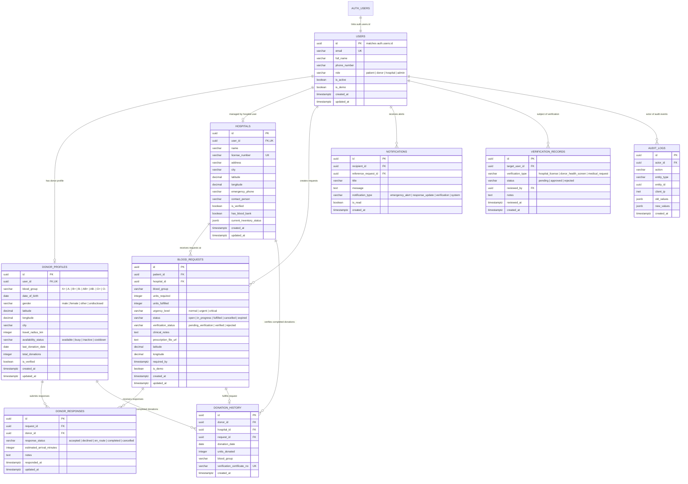

# LIFNEX — DATABASE DESIGN SPECIFICATION (3NF)

**Project:** Lifnex — Connecting Lives When Every Second Matters  
**Document Stage:** Phase 1 — Complete Project Planning & System Design  
**Database Engine:** Supabase PostgreSQL 15  
**Design Standard:** Third Normal Form (3NF), Row Level Security (RLS) Enforced

---

## 1. Entity-Relationship Model



---

## 2. Table Specifications & Schema Definitions

### 2.1 Table: `users`
Represents application-level user identities linked 1:1 with Supabase `auth.users`. Passwords and session secrets are managed solely by Supabase Auth and never duplicated here.

| Column | Type | Constraints | Description |
|---|---|---|---|
| `id` | `UUID` | `PRIMARY KEY, REFERENCES auth.users(id) ON DELETE CASCADE` | Matches Supabase Auth identity |
| `email` | `VARCHAR(255)` | `NOT NULL, UNIQUE` | Normalized user email |
| `full_name` | `VARCHAR(150)` | `NOT NULL` | Display name of the user |
| `phone_number` | `VARCHAR(30)` | `NULL` | Emergency contact number |
| `role` | `VARCHAR(30)` | `NOT NULL, CHECK (role IN ('patient', 'donor', 'hospital', 'admin'))` | Security role |
| `is_active` | `BOOLEAN` | `NOT NULL DEFAULT TRUE` | Active account status |
| `is_demo` | `BOOLEAN` | `NOT NULL DEFAULT TRUE` | Synthetic demo flag |
| `created_at` | `TIMESTAMPTZ` | `NOT NULL DEFAULT NOW()` | Record creation timestamp |
| `updated_at` | `TIMESTAMPTZ` | `NOT NULL DEFAULT NOW()` | Record update timestamp |

### 2.2 Table: `donor_profiles`
Maintains medical and geographic attributes for registered blood donors.

| Column | Type | Constraints | Description |
|---|---|---|---|
| `id` | `UUID` | `PRIMARY KEY DEFAULT gen_random_uuid()` | Unique donor profile identifier |
| `user_id` | `UUID` | `NOT NULL, UNIQUE, REFERENCES users(id) ON DELETE CASCADE` | Associated user identity |
| `blood_group` | `VARCHAR(5)` | `NOT NULL, CHECK (blood_group IN ('A+', 'A-', 'B+', 'B-', 'AB+', 'AB-', 'O+', 'O-'))` | Biological blood type |
| `date_of_birth` | `DATE` | `NOT NULL` | Age validation (>= 18 years) |
| `gender` | `VARCHAR(20)` | `CHECK (gender IN ('male', 'female', 'other', 'undisclosed'))` | Donor gender category |
| `latitude` | `DECIMAL(10, 7)` | `NOT NULL, CHECK (latitude BETWEEN -90.0 AND 90.0)` | Donor GPS latitude |
| `longitude` | `DECIMAL(10, 7)` | `NOT NULL, CHECK (longitude BETWEEN -180.0 AND 180.0)` | Donor GPS longitude |
| `city` | `VARCHAR(100)` | `NOT NULL` | Registered municipality |
| `travel_radius_km` | `INTEGER` | `NOT NULL DEFAULT 15, CHECK (travel_radius_km BETWEEN 1 AND 100)` | Max dispatch radius |
| `availability_status` | `VARCHAR(20)` | `NOT NULL DEFAULT 'available', CHECK (availability_status IN ('available', 'busy', 'inactive', 'cooldown'))` | Operational state |
| `last_donation_date` | `DATE` | `NULL` | Most recent donation date |
| `total_donations` | `INTEGER` | `NOT NULL DEFAULT 0, CHECK (total_donations >= 0)` | Verified donation count |
| `is_verified` | `BOOLEAN` | `NOT NULL DEFAULT FALSE` | Medical eligibility validation |
| `created_at` | `TIMESTAMPTZ` | `NOT NULL DEFAULT NOW()` | Creation timestamp |
| `updated_at` | `TIMESTAMPTZ` | `NOT NULL DEFAULT NOW()` | Last modification timestamp |

### 2.3 Table: `hospitals`
Accredited medical centers and blood banks facilitating blood requests and donations.

| Column | Type | Constraints | Description |
|---|---|---|---|
| `id` | `UUID` | `PRIMARY KEY DEFAULT gen_random_uuid()` | Unique hospital identifier |
| `user_id` | `UUID` | `NOT NULL, UNIQUE, REFERENCES users(id) ON DELETE CASCADE` | Hospital manager user ID |
| `name` | `VARCHAR(200)` | `NOT NULL` | Official hospital/bank name |
| `license_number` | `VARCHAR(100)` | `NOT NULL, UNIQUE` | Medical regulatory license |
| `address` | `TEXT` | `NOT NULL` | Full physical address |
| `city` | `VARCHAR(100)` | `NOT NULL` | City or region |
| `latitude` | `DECIMAL(10, 7)` | `NOT NULL, CHECK (latitude BETWEEN -90.0 AND 90.0)` | GPS latitude |
| `longitude` | `DECIMAL(10, 7)` | `NOT NULL, CHECK (longitude BETWEEN -180.0 AND 180.0)` | GPS longitude |
| `emergency_phone` | `VARCHAR(30)` | `NOT NULL` | 24/7 emergency desk line |
| `contact_person` | `VARCHAR(100)` | `NOT NULL` | Chief medical officer / desk lead |
| `is_verified` | `BOOLEAN` | `NOT NULL DEFAULT FALSE` | Administrative verification |
| `has_blood_bank` | `BOOLEAN` | `NOT NULL DEFAULT TRUE` | Cold-chain storage capacity |
| `current_inventory_status` | `JSONB` | `DEFAULT '{}'::JSONB` | Approximate demo blood reserve levels |
| `created_at` | `TIMESTAMPTZ` | `NOT NULL DEFAULT NOW()` | Creation timestamp |
| `updated_at` | `TIMESTAMPTZ` | `NOT NULL DEFAULT NOW()` | Last modification timestamp |

### 2.4 Table: `blood_requests`
Primary coordination records initiated by patients or hospitals in urgent need.

| Column | Type | Constraints | Description |
|---|---|---|---|
| `id` | `UUID` | `PRIMARY KEY DEFAULT gen_random_uuid()` | Unique request identifier |
| `patient_id` | `UUID` | `NOT NULL, REFERENCES users(id) ON DELETE CASCADE` | Requesting patient or proxy |
| `hospital_id` | `UUID` | `NOT NULL, REFERENCES hospitals(id) ON DELETE RESTRICT` | Target healthcare facility |
| `blood_group` | `VARCHAR(5)` | `NOT NULL, CHECK (blood_group IN ('A+', 'A-', 'B+', 'B-', 'AB+', 'AB-', 'O+', 'O-'))` | Required blood group |
| `units_required` | `INTEGER` | `NOT NULL, CHECK (units_required BETWEEN 1 AND 20)` | Requested units |
| `units_fulfilled` | `INTEGER` | `NOT NULL DEFAULT 0, CHECK (units_fulfilled >= 0)` | Completed donor units |
| `urgency_level` | `VARCHAR(20)` | `NOT NULL DEFAULT 'urgent', CHECK (urgency_level IN ('normal', 'urgent', 'critical'))` | Clinical priority |
| `status` | `VARCHAR(20)` | `NOT NULL DEFAULT 'open', CHECK (status IN ('open', 'in_progress', 'fulfilled', 'cancelled', 'expired'))` | Request state |
| `verification_status` | `VARCHAR(30)` | `NOT NULL DEFAULT 'pending_verification', CHECK (verification_status IN ('pending_verification', 'verified', 'rejected'))` | Medical desk verification |
| `clinical_notes` | `TEXT` | `NULL` | Condition context / reason |
| `prescription_file_url` | `TEXT` | `NULL` | Supabase Storage signed URL |
| `latitude` | `DECIMAL(10, 7)` | `NOT NULL` | Hospital delivery GPS latitude |
| `longitude` | `DECIMAL(10, 7)` | `NOT NULL` | Hospital delivery GPS longitude |
| `required_by` | `TIMESTAMPTZ` | `NOT NULL` | Deadline for donation arrival |
| `is_demo` | `BOOLEAN` | `NOT NULL DEFAULT TRUE` | Synthetic demo tag |
| `created_at` | `TIMESTAMPTZ` | `NOT NULL DEFAULT NOW()` | Broadcast timestamp |
| `updated_at` | `TIMESTAMPTZ` | `NOT NULL DEFAULT NOW()` | Last update timestamp |

### 2.5 Table: `donor_responses`
Tracks interaction of individual notified donors with an active request.

| Column | Type | Constraints | Description |
|---|---|---|---|
| `id` | `UUID` | `PRIMARY KEY DEFAULT gen_random_uuid()` | Response identifier |
| `request_id` | `UUID` | `NOT NULL, REFERENCES blood_requests(id) ON DELETE CASCADE` | Associated blood request |
| `donor_id` | `UUID` | `NOT NULL, REFERENCES donor_profiles(id) ON DELETE CASCADE` | Responding donor |
| `response_status` | `VARCHAR(20)` | `NOT NULL, CHECK (response_status IN ('accepted', 'declined', 'en_route', 'completed', 'cancelled'))` | Response state |
| `estimated_arrival_minutes` | `INTEGER` | `NULL, CHECK (estimated_arrival_minutes >= 0)` | Expected ETA |
| `notes` | `TEXT` | `NULL` | Donor notes or comments |
| `responded_at` | `TIMESTAMPTZ` | `NOT NULL DEFAULT NOW()` | Response timestamp |
| `updated_at` | `TIMESTAMPTZ` | `NOT NULL DEFAULT NOW()` | Status update timestamp |

### 2.6 Table: `notifications`
Realtime and asynchronous user notifications.

| Column | Type | Constraints | Description |
|---|---|---|---|
| `id` | `UUID` | `PRIMARY KEY DEFAULT gen_random_uuid()` | Notification ID |
| `recipient_id` | `UUID` | `NOT NULL, REFERENCES users(id) ON DELETE CASCADE` | Recipient user ID |
| `reference_request_id` | `UUID` | `NULL, REFERENCES blood_requests(id) ON DELETE SET NULL` | Linked blood request |
| `title` | `VARCHAR(150)` | `NOT NULL` | Alert title |
| `message` | `TEXT` | `NOT NULL` | Body text |
| `notification_type` | `VARCHAR(30)` | `NOT NULL, CHECK (notification_type IN ('emergency_alert', 'response_update', 'verification', 'system'))` | Alert classification |
| `is_read` | `BOOLEAN` | `NOT NULL DEFAULT FALSE` | Read receipt |
| `created_at` | `TIMESTAMPTZ` | `NOT NULL DEFAULT NOW()` | Creation timestamp |

### 2.7 Table: `donation_history`
Immutable ledger of completed blood donations for cooldown tracking and donor badges.

| Column | Type | Constraints | Description |
|---|---|---|---|
| `id` | `UUID` | `PRIMARY KEY DEFAULT gen_random_uuid()` | Donation record ID |
| `donor_id` | `UUID` | `NOT NULL, REFERENCES donor_profiles(id) ON DELETE RESTRICT` | Contributing donor |
| `hospital_id` | `UUID` | `NOT NULL, REFERENCES hospitals(id) ON DELETE RESTRICT` | Certifying hospital |
| `request_id` | `UUID` | `NULL, REFERENCES blood_requests(id) ON DELETE SET NULL` | Satisfied request |
| `donation_date` | `DATE` | `NOT NULL DEFAULT CURRENT_DATE` | Date of donation |
| `units_donated` | `INTEGER` | `NOT NULL DEFAULT 1, CHECK (units_donated > 0)` | Units transferred |
| `blood_group` | `VARCHAR(5)` | `NOT NULL` | Donated blood group |
| `verification_certificate_no` | `VARCHAR(100)` | `NOT NULL, UNIQUE` | Hospital verification serial |
| `created_at` | `TIMESTAMPTZ` | `NOT NULL DEFAULT NOW()` | Recording timestamp |

### 2.8 Table: `verification_records`
Audit trail of identity, clinical, or hospital accreditation checks.

| Column | Type | Constraints | Description |
|---|---|---|---|
| `id` | `UUID` | `PRIMARY KEY DEFAULT gen_random_uuid()` | Verification record ID |
| `target_user_id` | `UUID` | `NOT NULL, REFERENCES users(id) ON DELETE CASCADE` | Target user account |
| `verification_type` | `VARCHAR(50)` | `NOT NULL, CHECK (verification_type IN ('hospital_license', 'donor_health_screen', 'medical_request'))` | Audit scope |
| `status` | `VARCHAR(20)` | `NOT NULL DEFAULT 'pending', CHECK (status IN ('pending', 'approved', 'rejected'))` | Decision |
| `reviewed_by` | `UUID` | `NULL, REFERENCES users(id) ON DELETE SET NULL` | Reviewing admin |
| `notes` | `TEXT` | `NULL` | Reviewer notes |
| `reviewed_at` | `TIMESTAMPTZ` | `NULL` | Decision timestamp |
| `created_at` | `TIMESTAMPTZ` | `NOT NULL DEFAULT NOW()` | Submission timestamp |

### 2.9 Table: `audit_logs`
Security and administrative trail for all critical state changes.

| Column | Type | Constraints | Description |
|---|---|---|---|
| `id` | `UUID` | `PRIMARY KEY DEFAULT gen_random_uuid()` | Audit event ID |
| `actor_id` | `UUID` | `NULL, REFERENCES users(id) ON DELETE SET NULL` | Performing user ID |
| `action` | `VARCHAR(100)` | `NOT NULL` | Event tag (e.g., 'REQUEST_OVERRIDE') |
| `entity_type` | `VARCHAR(50)` | `NOT NULL` | Target table name |
| `entity_id` | `UUID` | `NULL` | Target record UUID |
| `client_ip` | `INET` | `NULL` | Client IP address |
| `old_values` | `JSONB` | `NULL` | State before mutation |
| `new_values` | `JSONB` | `NULL` | State after mutation |
| `created_at` | `TIMESTAMPTZ` | `NOT NULL DEFAULT NOW()` | Log timestamp |

---

## 3. Database Indexes for High-Speed Matching

```sql
-- Fast index for location and availability searches
CREATE INDEX idx_donor_matching ON donor_profiles (blood_group, availability_status, last_donation_date);

-- Fast lookup for open blood requests
CREATE INDEX idx_requests_open ON blood_requests (status, urgency_level, blood_group);

-- Spatial coordinate index
CREATE INDEX idx_hospitals_coords ON hospitals (latitude, longitude);
CREATE INDEX idx_donors_coords ON donor_profiles (latitude, longitude);

-- Foreign key search optimizations
CREATE INDEX idx_donor_responses_req ON donor_responses (request_id, donor_id);
CREATE INDEX idx_notifications_recipient ON notifications (recipient_id, is_read);
```

---

## 4. Row Level Security (RLS) Strategy

| Table | SELECT Policy | INSERT Policy | UPDATE Policy | DELETE Policy |
|---|---|---|---|---|
| `users` | Authenticated users can view own profile; Admins view all | Authenticated user can create own profile (`id = auth.uid()`) | User can update own non-role fields; Admins can update all | Admin only |
| `donor_profiles` | Donors view own profile; Hospitals & Patients can view public attributes (blood group, city) without private contact info; Admin views all | Donor can create own profile (`user_id = auth.uid()`) | Donor updates own profile | Donor / Admin |
| `hospitals` | Public read for all verified hospitals | Hospital admin user on registration | Hospital owner updates own facility details | Admin only |
| `blood_requests` | Public read for open requests; Detailed view for creator, matched donors, and attending hospital | Authenticated patients and hospitals | Request owner (patient/hospital) or Admin | Admin only |
| `donor_responses` | Request creator, responding donor, and attending hospital | Matched donors only | Responding donor only | Responding donor / Admin |
| `notifications` | Recipient only (`recipient_id = auth.uid()`) | System / Backend service role | Recipient can mark `is_read = true` | Recipient only |
| `donation_history` | Donor views own history; Hospital views records it verified; Admin views all | Hospital role only | Admin only | Admin only |
| `verification_records` | Target user can view; Admins have full access | System / Target user submission | Admin only | Admin only |
| `audit_logs` | Admin only | Backend service role only | Read-only (NO UPDATE) | Read-only (NO DELETE) |

