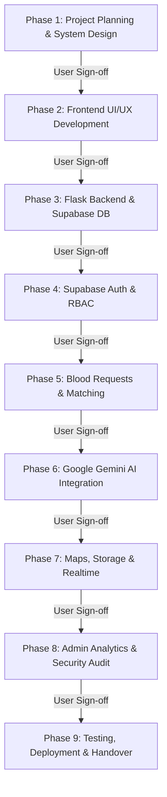

# LIFNEX — NINE-PHASE DEVELOPMENT ROADMAP

**Project:** Lifnex — Connecting Lives When Every Second Matters  
**Document Stage:** Phase 1 — Complete Project Planning & System Design  
**Governance:** Strict Sequential Phase Execution with User Approval Gates

---

## 1. Roadmap Overview & Milestones

The Lifnex project is structured into nine rigorous, sequential development phases. Each phase delivers a functional, tested increment with clear completion gates.

---

## 2. Phase-by-Phase Breakdown

### Phase 1: Project Planning and System Design (CURRENT PHASE)
- **Objective**: Establish the complete foundational architecture, database schema, security model, API design, UI system, asset catalog, and roadmap before any coding starts.
- **Key Deliverables**:
  - `PROJECT_OVERVIEW.md`
  - `REQUIREMENTS.md`
  - `SYSTEM_ARCHITECTURE.md`
  - `DATABASE_DESIGN_PLAN.md`
  - `API_DESIGN_PLAN.md`
  - `SECURITY_THREAT_MODEL.md`
  - `UI_DESIGN_SYSTEM.md`
  - `DEVELOPMENT_ROADMAP.md`
  - `SUPABASE_SETUP_GUIDE.md`
  - `ASSET_INVENTORY.md`
  - `PHASE_1_COMPLETION_REPORT.md`
- **Completion Criteria**: Complete documentation suite created, original assets cataloged without alterations, strict zero-Azure compliance, and user approval received to advance.

---

### Phase 2: Complete Frontend UI/UX Development
- **Objective**: Build the full client-side interface using HTML5, modern CSS3, and Vanilla JavaScript, grounded in the provided assets in `demo-assests/`.
- **Key Deliverables**:
  - Landing page with hero banner (`63880284821092a1499a052d23a92755.jpg`) and brand logo (`Lifnex AI Blood Donor Network Logo...png`).
  - Interactive Patient Emergency Request portal.
  - Voluntary Donor Dashboard with availability toggles and accept/decline cards.
  - Hospital Coordination Center with verified case tracking.
  - Administrative monitoring view.
  - Blood Compatibility Matrix widget.
  - Leaflet map container component and Chart.js analytics layout.
  - Pure CSS design system with light/dark theme support.
- **Completion Criteria**: Fully responsive, high-fidelity frontend running locally with synthetic mock data bindings before backend connection.

---

### Phase 3: Flask Backend and Supabase PostgreSQL Integration
- **Objective**: Implement Python Flask backend API and configure the Supabase PostgreSQL database schema.
- **Key Deliverables**:
  - Python virtual environment and `requirements.txt` (`Flask`, `supabase`, `python-dotenv`, `marshmallow`, `gunicorn`, `requests`).
  - Modular Flask application structure with Blueprints (`requests`, `donors`, `hospitals`, `auth`, `matching`, `admin`).
  - Supabase SQL migration script applying 3NF schema, constraints, and indexes.
  - PostgreSQL database connection verification via Supabase client.
  - Centralized error handling and JSON API formatting middleware.
- **Completion Criteria**: Flask server boots cleanly, connects to Supabase PostgreSQL, and executes CRUD database operations via REST endpoints.

---

### Phase 4: Supabase Authentication and Role-Based Access Control (RBAC)
- **Objective**: Wire client and backend to Supabase Auth with strict role segregation.
- **Key Deliverables**:
  - User signup and login flows for Patient, Donor, and Hospital.
  - Automatic synchronization between Supabase `auth.users` and `public.users`.
  - JWT extraction and verification middleware in Flask.
  - Row Level Security (RLS) policies activated and verified in Supabase PostgreSQL.
  - Protected API routes enforcing role validation (`@require_role('admin')`, `@require_role('hospital')`).
- **Completion Criteria**: Unauthorized requests are rejected with 401/403, and users cannot escalate their roles via client payloads.

---

### Phase 5: Blood Request Management and Donor Matching Engine
- **Objective**: Implement the emergency broadcast lifecycle and mathematical proximity-based donor matching.
- **Key Deliverables**:
  - Request creation endpoint with blood group validation and hospital assignment.
  - ABO/Rh biological compatibility algorithm.
  - Haversine great-circle distance calculation engine in Python backend.
  - Donor discovery query filtering by compatibility, distance radius, and cooldown status.
  - Donor accept / decline response endpoints with ETA capture.
  - Request fulfillment logic updating request counters.
- **Completion Criteria**: An emergency request correctly identifies compatible nearby donors within radius and updates state upon donor acceptance.

---

### Phase 6: Google Gemini AI Integration
- **Objective**: Incorporate Google Gemini API to assist patients, donors, and administrators.
- **Key Deliverables**:
  - Gemini API client wrapper with exponential backoff and timeout handling.
  - Emergency Triage Assistant endpoint parsing unstructured medical notes into structured blood request fields.
  - Donor Advisory Assistant explaining compatibility and pre-donation hydration/rest requirements.
  - Synthetic data analysis generator summarizing regional emergency frequency for admin reports.
- **Completion Criteria**: Gemini API requests succeed securely from the backend without exposing the API key to frontend clients.

---

### Phase 7: Maps, Notifications, Storage and Realtime
- **Objective**: Deliver interactive geospatial mapping, instant live updates, and secure medical document storage.
- **Key Deliverables**:
  - Leaflet.js and OpenStreetMap integration plotting hospital and donor coordinates with custom map pins.
  - Supabase Realtime WebSocket listeners in Vanilla JS for immediate alert dispatch.
  - In-app notification center for donors and patients.
  - Supabase Storage bucket for emergency medical prescriptions and hospital accreditation files with signed URLs.
- **Completion Criteria**: Creating an emergency request updates the connected donor screen in real-time without browser page refresh.

---

### Phase 8: Admin Analytics, Database Optimization and Security Audit
- **Objective**: Finalize governance tooling, optimize query performance, and conduct comprehensive security hardening.
- **Key Deliverables**:
  - Chart.js powered Admin Analytics dashboard (blood group demand distribution, average response duration, regional heatmaps).
  - SQL query optimization and index tuning.
  - STRIDE threat model verification and OWASP API security audit.
  - Comprehensive audit log viewer for administrators.
  - Demonstration mode banner enforcement across all views.
- **Completion Criteria**: Zero exposed credentials, all RLS policies validated, audit logs capturing state mutations, and sub-second analytics response.

---

### Phase 9: Testing, Deployment, GitHub and Final Documentation
- **Objective**: Verify end-to-end functionality, deploy to production on Render, push to GitHub, and deliver project documentation.
- **Key Deliverables**:
  - Automated test suite (Pytest for API endpoints, frontend smoke tests).
  - Render deployment configuration (`render.yaml` or build/start commands).
  - Production environment configuration and SSL verification.
  - Clean GitHub repository commit history.
  - Final project report, presentation deck outline, and user manual.
- **Completion Criteria**: Live working deployment on Render connected to Supabase PostgreSQL, zero errors in console, and clean GitHub repository.

