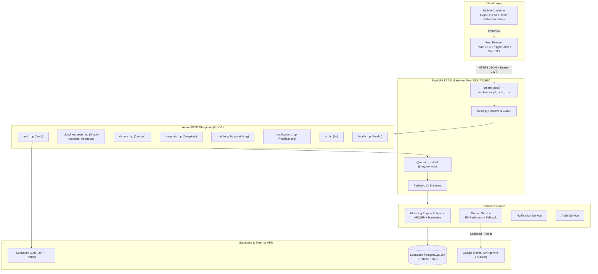
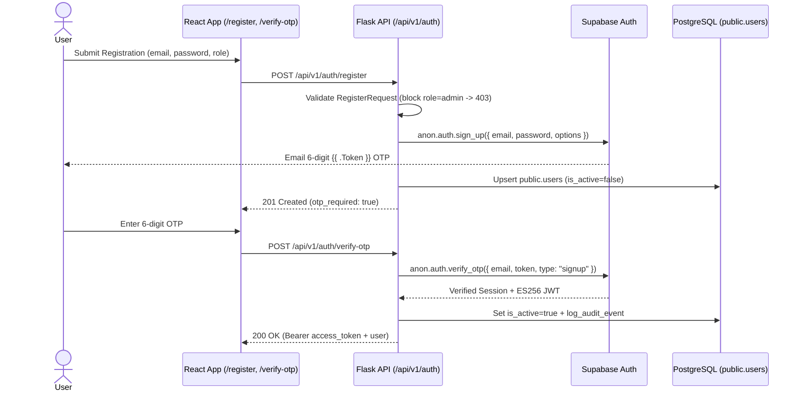
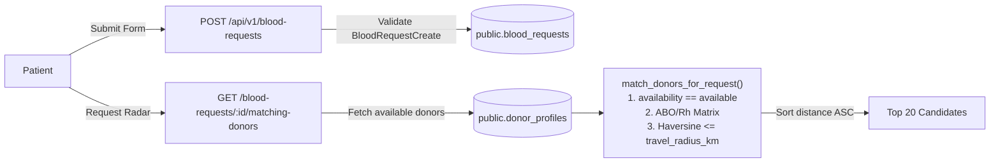
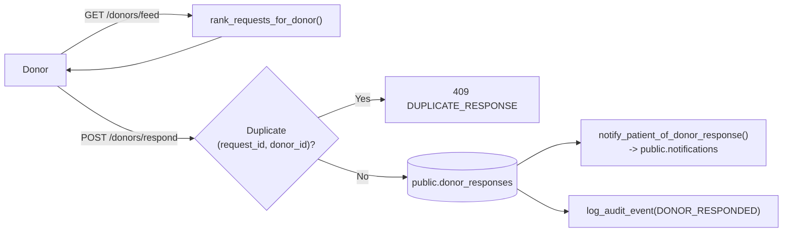
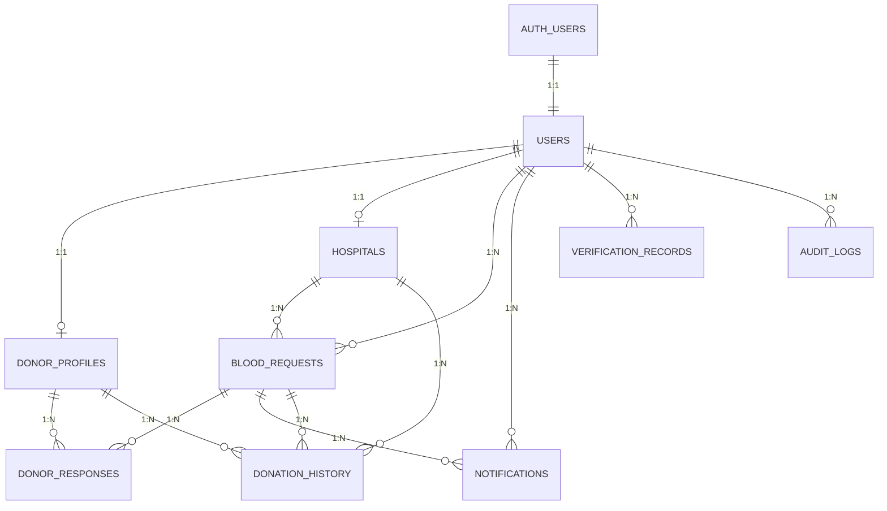

<div align="center">
  

  <h1>LIFNEX</h1>
  <p><strong>Connecting Lives When Every Second Matters.</strong></p>
  <p>
    <em>An intelligent emergency blood donor coordination platform connecting patients, voluntary blood donors, accredited hospitals, and platform administrators through a unified digital coordination system.</em>
  </p>

  <p>
    
    
    
    
    
    
    
  </p>

  <p>
    <a href="#-project-overview">Overview</a> •
    <a href="#-complete-feature-documentation">Features</a> •
    <a href="#-system-architecture">Architecture</a> •
    <a href="#-database-architecture--er-diagram">Database</a> •
    <a href="#-api-architecture--reference">API</a> •
    <a href="#-algorithms--technical-complexity">Algorithms</a> •
    <a href="#-website-ui--product-screenshots">Screenshots</a> •
    <a href="#-installation--local-setup">Setup</a>
  </p>

  <br />
  
  <br />
  <sub><em>Live Lifnex landing page featuring the interactive Three.js <code>BloodStream</code> 3D red blood cell visualization and variable-proximity typography.</em></sub>
</div>

---

> [!IMPORTANT]
> **Medical & Regulatory Scope Boundary:**  
> **Lifnex is strictly a digital emergency logistics, donor discovery, and coordination platform.**  
> Lifnex is **not** a blood bank, does not store or transport physical blood units, and does not perform clinical diagnosis, donor medical eligibility certification, or laboratory cross-matching. All biological compatibility and transfusion decisions must be performed on-site by licensed medical professionals under National Blood Transfusion Council (NBTC) guidelines.

---

## 📑 Table of Contents

1. [Project Overview](#-project-overview)
2. [Complete Feature Documentation](#-complete-feature-documentation)
3. [System Architecture](#-system-architecture)
4. [System Data Flow](#-system-data-flow)
5. [Database Architecture & ER Diagram](#-database-architecture--er-diagram)
6. [API Architecture & Reference](#-api-architecture--reference)
7. [Algorithms & Technical Complexity](#-algorithms--technical-complexity)
8. [Authentication & Security Architecture](#-authentication--security-architecture)
9. [AI & Intelligent Features](#-ai--intelligent-features)
10. [Technology Stack](#-technology-stack)
11. [Installation & Local Setup](#-installation--local-setup)
12. [Environment Variables](#-environment-variables)
13. [Testing & Quality Assurance](#-testing--quality-assurance)
14. [Website UI & Product Screenshots](#-website-ui--product-screenshots)
15. [Project Directory Structure](#-project-directory-structure)
16. [Engineering Complexity & Technical Contributions](#-engineering-complexity--technical-contributions)
17. [System Limitations & Future Roadmap](#-system-limitations--future-roadmap)
18. [Supporting Documentation](#-supporting-documentation)
19. [Project Team, Contributing & License](#-project-team-contributing--license)

---

## 🎯 Project Overview

<table>
  <tr>
    <td width="58%" valign="top">
      <h3>Problem Statement</h3>
      <p>Emergency blood coordination in critical care frequently suffers from structural bottlenecks:</p>
      <ul>
        <li><strong>Fragmented Donor Discovery:</strong> Compatible voluntary donors are scattered across uncoordinated registries and informal chat groups.</li>
        <li><strong>Communication Latency:</strong> Urgent requisitions lose critical minutes to manual phone trees and unverified broadcasts.</li>
        <li><strong>Geographic Opacity:</strong> Nearby compatible donors remain unaware of urgent hospital needs within their travel radius.</li>
        <li><strong>Lack of Status Visibility:</strong> Patients and hospital intake desks lack centralized visibility into whether requests were received, accepted, or fulfilled.</li>
        <li><strong>Multi-Request Complexity:</strong> Hospitals and coordinators struggle to prioritize simultaneous urgent and critical requisitions.</li>
      </ul>
    </td>
    <td width="42%" align="center" valign="middle">
      <br />
      <sub><em>Editorial clinical coordination artwork used in <code>AboutPage.tsx</code> (<code>frontend/static/assets/images/hero-medical-team.jpg</code>).</em></sub>
    </td>
  </tr>
</table>

### Proposed Solution
Lifnex unifies four role-isolated portals (**Patient**, **Donor**, **Hospital**, **Admin**) backed by a Python Flask REST API, Supabase Auth, and PostgreSQL with Row-Level Security (RLS):
- **Structured Emergency Requisitions:** Validated requests with blood group, units required (`1–20`), urgency tier (`critical`, `urgent`, `normal`), coordinates, and clinical notes.
- **Algorithmic Donor Discovery:** Pre-filters candidates by `availability_status`, ABO/Rh compatibility matrix, and Haversine great-circle distance within each donor's configured `travel_radius_km` (`1–100 km`).
- **Bilateral Handshake & Notifications:** Donors accept or decline requests with an estimated arrival time (`ETA`), persisting records to `donor_responses` and alerting patients via `notifications`.
- **AI Triage & Clinical Governance:** Google Gemini integration (`gemini-2.5-flash`) with deterministic fallback, pre-execution PII redaction, prompt-injection defense, and mandatory NBTC disclaimers.

### Target Users & Roles

| Role | Responsibilities & Portal Access | Registration Policy |
|---|---|---|
| **Patient** (`/dashboard/patient`) | Submit emergency blood requests, view ranked matching donors, track donor responses, cancel open requests. | Public self-registration + email OTP verification |
| **Donor** (`/dashboard/donor`) | Toggle availability (`available`, `busy`, `inactive`), view compatibility-ranked nearby requests, submit accept/decline responses with ETA, view history. | Public self-registration + email OTP verification |
| **Hospital** (`/dashboard/hospital`) | Register facility profile with license number, manage cryo-reserve inventory status, coordinate incoming requests. | Public registration (`is_verified = false` until Admin approves) |
| **Admin** (`/dashboard/admin`) | Approve hospital accreditation (`PATCH /hospitals/<id>/verify`), monitor platform analytics & AI insights, inspect audit logs. | Restricted; public self-registration blocked (`403 FORBIDDEN`) |

### Project Scope Matrix

| Status | Capabilities Verified in Source Code |
|---|---|
| **Implemented** | Multi-role React 18 SPA with Three.js `BloodStream` 3D visuals & ReactBits primitives, Flask REST API (7 active blueprints), Supabase Auth native signup & 6-digit email OTP, JWKS (`ES256`/`RS256`) + `HS256` auth guard, ABO/Rh compatibility matrix, Haversine distance ranking, duplicate-safe donor handshake, persisted notifications, Gemini AI triage with PII scrubbing & fallback, 9-table PostgreSQL schema + `002_security_hardening.sql` RLS, 97 automated Pytest tests. |
| **Partially Implemented** | Real-time delivery uses persisted `public.notifications` queried via REST polling rather than live WebSockets/push; hospital cryo-reserve telemetry and admin trend charts combine API state with demonstration datasets; React SPA geolocation uses canvas `GeofenceRadar` while `leaflet` (`1.9.4`) is present in `package.json` and legacy `frontend/static/js/maps.js`; `mobile/` provides an Expo SDK 51 WebView container without native push bindings. |
| **Deferred / Planned** | Physical Android `.apk` build via EAS (`mobile/eas.json` configured, build deferred); Azure Database for PostgreSQL Flexible Server DR target; e-RaktKosh blood bank API integration; Redis-backed distributed rate limiting. |
| **Out of Scope** | Physical blood storage/transport, medical eligibility certification, automated clinical cross-matching, or autonomous medical diagnosis. |

---

## 🧩 Complete Feature Documentation

### 1. Patient Module (`frontend/src/pages/dashboards/PatientDashboard.tsx`, `backend/app/routes/blood_requests.py`)
- **Authentication & Verification:** Registers via `POST /api/v1/auth/register` and activates via 6-digit Supabase OTP (`POST /api/v1/auth/verify-otp`).
- **Emergency Requisition Creation:** Submits `POST /api/v1/blood-requests` validated by `BloodRequestCreate` (blood group, units `1–20`, urgency, receiving hospital, coordinates, `required_by`). Forces `patient_id = g.user["id"]` for patient callers.
- **Donor Matching & Tracking:** Fetches ranked compatible donors via `GET /api/v1/blood-requests/<id>/matching-donors` and donor responses via `GET /api/v1/blood-requests/<id>/responses`. Enforces ownership check (`403` if another patient requests it).
- **Cancellation:** Cancels `open` or `in_progress` requisitions via `PATCH /api/v1/blood-requests/<id>/cancel`.

<div align="center">
  <br />
  <sub><em>Actual Patient Emergency Portal showing active requisitions, matching donor panel, and status controls.</em></sub>
</div>

### 2. Donor Module (`frontend/src/pages/dashboards/DonorDashboard.tsx`, `backend/app/routes/donors.py`)
- **Availability Management:** Toggles `available`, `busy`, or `inactive` via `PATCH /api/v1/donors/availability`.
- **Ranked Emergency Feed & Geofence Radar:** `GET /api/v1/donors/feed` retrieves open/in-progress requests filtered by ABO/Rh compatibility and `travel_radius_km`, ranked by urgency (`critical` > `urgent` > `normal`) then Haversine distance, paired with `GeofenceRadar.tsx`.
- **Bilateral Handshake:** `POST /api/v1/donors/respond` records `accepted`/`declined`/`en_route` responses with `estimated_arrival_minutes`. Enforces duplicate prevention (`409 DUPLICATE_RESPONSE` in both Python and PostgreSQL `UNIQUE (request_id, donor_id)`), notifies the patient, and logs an audit entry.
- **Donation History:** `GET /api/v1/donors/history` returns past responses and verified donation records.

<div align="center">
  <br />
  <sub><em>Actual Voluntary Donor Portal with live availability switch, travel radius metric, and emergency priority feed.</em></sub>
</div>

### 3. Hospital Module (`frontend/src/pages/dashboards/HospitalDashboard.tsx`, `frontend/src/pages/public/HospitalsPage.tsx`, `backend/app/routes/hospitals.py`)
- **Facility Directory:** `GET /api/v1/hospitals` lists verified facilities with optional `?city=` case-insensitive filtering.
- **Facility Registration & Accreditation:** `POST /api/v1/hospitals` registers a facility with `license_number`, coordinates, and `current_inventory_status` JSONB. Non-admin registrations default to `is_verified = false` until accredited.

<div align="center">
  <br />
  <sub><em>Actual Hospital Coordination Desk showing active trauma cases, cold-chain reserve status, and requisition triage actions.</em></sub>
</div>

### 4. Admin Module (`frontend/src/pages/dashboards/AdminDashboard.tsx`, `backend/app/routes/hospitals.py`, `backend/app/routes/ai.py`)
- **Hospital Accreditation:** `PATCH /api/v1/hospitals/<id>/verify` (restricted to `@require_roles("admin")`) sets `is_verified = true` and records `HOSPITAL_VERIFIED` in `audit_logs`.
- **AI Demand Insights & Audit Oversight:** `GET`/`POST /api/v1/ai/admin-insights` (restricted to `@require_roles("admin")`) summarizes platform demand metrics and logs `AI_ADMIN_INSIGHTS_GENERATED`. *(Note: Compliance labels such as "HIPAA, GDPR, NBTC" shown in the UI cards are demonstration UI indicators rather than verified external legal certifications.)*

<div align="center">
  <br />
  <sub><em>Actual Admin Executive Command Terminal with Recharts 7-day dispatch telemetry and command navigation.</em></sub>
</div>

### 5. Supporting Systems
- **Notifications (`backend/app/routes/notifications.py`):** Owner-scoped listing (`?unread_only=true`), single-item read (`PATCH /notifications/<id>/read`), and bulk mark-read (`PATCH /notifications/mark-all-read`).
- **Geospatial & Compatibility (`backend/app/api/v1/matching.py`, `GeofenceRadar.tsx`):** Public compatibility lookup (`GET /api/v1/matching/compatibility`) and Haversine preview (`POST /api/v1/matching/distance-preview`), rendered on the donor portal via `GeofenceRadar` and in legacy static templates via `leaflet` (`1.9.4`).
- **Audit Logging (`backend/app/services/audit_service.py`):** Persists actor, action, entity type/ID, client IP, and JSONB `old_values`/`new_values` to `public.audit_logs`.

<table>
  <tr>
    <td width="55%" align="center" valign="middle">
      <br />
      <sub><em>Live <code>GeofenceRadar</code> component in <code>DonorDashboard.tsx</code> visualizing the donor's 15 km dispatch geofence.</em></sub>
    </td>
    <td width="45%" align="center" valign="middle">
      <br />
      <sub><em>Editorial specimen verification graphic used in <code>AboutPage.tsx</code> (<code>frontend/static/assets/images/clinical-verification.jpg</code>).</em></sub>
    </td>
  </tr>
</table>

---

## 🏗️ System Architecture

> Detailed component breakdown available in [docs/ARCHITECTURE.md](docs/ARCHITECTURE.md).



### Key Architectural Decisions
- **Unified Single-Origin Serving:** In production (`run.py` / Render) and serverless (`api/index.py` / Vercel), Flask serves both `/api/v1/*` and the compiled Vite `frontend/dist/` bundle, eliminating cross-origin header friction.
- **Zero-Trust Backend Proxy for Database Mutations:** The frontend never embeds `SUPABASE_SECRET_KEY`. All privileged mutations pass through Flask `@require_auth` / `@require_roles` middleware and Pydantic validation before reaching PostgreSQL.
- **Multi-Entry HTML Shells:** `scripts/make-shells.js` generates 17 HTML entrypoints (`login.html`, `dashboard/patient.html`, etc.) in `vite.config.ts` so direct deep links resolve cleanly without SPA 404s.

---

## 🔄 System Data Flow

> Full set of 5 workflow diagrams in [docs/USER_WORKFLOWS.md](docs/USER_WORKFLOWS.md).

### Flow A — Native Supabase Auth & 6-Digit Email OTP


### Flow B & C — Emergency Blood Request & Donor Discovery


### Flow D — Donor Response & Notification Handshake


---

## 🗄️ Database Architecture & ER Diagram

> Full column types, indexes, and RLS function definitions are documented in [docs/DATABASE_DESIGN.md](docs/DATABASE_DESIGN.md).



### Core Relational Tables (`backend/migrations/001_initial_schema.sql`)

| # | Table | Primary Key | Key Relationships & Constraints |
|---|---|---|---|
| 1 | `public.users` | `id` (`UUID`) | References `auth.users(id)` `CASCADE`; `email` UNIQUE; `role IN ('patient','donor','hospital','admin')`. |
| 2 | `public.donor_profiles` | `id` (`UUID`) | `user_id` UNIQUE FK `users(id)`; 8 ABO/Rh values; `travel_radius_km` `1–100`; `availability_status` check. |
| 3 | `public.hospitals` | `id` (`UUID`) | `user_id` UNIQUE FK `users(id)`; `license_number` UNIQUE; JSONB `current_inventory_status` object check. |
| 4 | `public.blood_requests` | `id` (`UUID`) | `patient_id` -> `users(id)`, `hospital_id` -> `hospitals(id)`; `units_required` `1–20`; `units_fulfilled <= units_required`. |
| 5 | `public.donor_responses` | `id` (`UUID`) | `UNIQUE (request_id, donor_id)` constraint; `estimated_arrival_minutes >= 0`. |
| 6 | `public.notifications` | `id` (`UUID`) | `recipient_id` -> `users(id)`, `reference_request_id` -> `blood_requests(id)`. |
| 7 | `public.donation_history` | `id` (`UUID`) | `donor_id`, `hospital_id`, `request_id`; `verification_certificate_no` UNIQUE. |
| 8 | `public.verification_records` | `id` (`UUID`) | `target_user_id`, `reviewed_by` -> `users(id)`; `verification_type` check. |
| 9 | `public.audit_logs` | `id` (`UUID`) | `actor_id` -> `users(id)`; `client_ip INET`; `old_values`/`new_values` JSONB. |

### Database Security (`backend/migrations/002_security_hardening.sql`)
- **Fail-Closed Base:** Migration `001` enables RLS on all 9 tables and revokes all permissions from `anon` and `authenticated` until Migration `002` runs.
- **Hardened Helper Functions:** Migration `002` installs `SECURITY DEFINER` helpers (`get_auth_user_role()`, `is_admin()`, `is_verified_hospital()`, etc.) pinned to `SET search_path = public, pg_temp` with `PUBLIC` execution revoked.

---

## 🌐 API Architecture & Reference

> Complete request/response schemas and error codes are documented in [docs/API_REFERENCE.md](docs/API_REFERENCE.md).

| Module | Method | Route | Auth | Authorized Roles |
|---|---|---|---|---|
| **Health** | `GET` | `/api/v1/health` | No | Public |
| **Auth** | `POST` | `/api/v1/auth/register` | No | Public (`patient`, `donor`, `hospital`) |
| **Auth** | `POST` | `/api/v1/auth/verify-otp` | No | Public |
| **Auth** | `POST` | `/api/v1/auth/resend-otp` | No | Public |
| **Auth** | `POST` | `/api/v1/auth/login` | No | Public |
| **Auth** | `POST` | `/api/v1/auth/logout` | Yes | Any authenticated user |
| **Auth** | `POST` | `/api/v1/auth/forgot-password` | No | Public |
| **Auth** | `POST` | `/api/v1/auth/reset-password` | No | Public (requires recovery token) |
| **Auth** | `GET` | `/api/v1/auth/me` | Yes | Any authenticated user |
| **Requests** | `GET` | `/api/v1/blood-requests` *(alias `/api/v1/requests`)* | No | Public |
| **Requests** | `POST` | `/api/v1/blood-requests` | Yes | `patient`, `hospital`, `admin` |
| **Requests** | `GET` | `/api/v1/blood-requests/<id>/matching-donors` | Yes | Owner `patient`, `hospital`, `admin` |
| **Requests** | `PATCH` | `/api/v1/blood-requests/<id>/cancel` | Yes | Owner `patient`, `admin` |
| **Requests** | `GET` | `/api/v1/blood-requests/<id>/responses` | Yes | Owner `patient`, `hospital`, `admin` |
| **Donors** | `PATCH` | `/api/v1/donors/availability` | No* | Donor (*accepts `donor_id`) |
| **Donors** | `GET` | `/api/v1/donors/feed` | Yes | `donor`, `admin` |
| **Donors** | `POST` | `/api/v1/donors/respond` | Yes | `donor`, `admin` |
| **Donors** | `GET` | `/api/v1/donors/history` | Yes | `donor`, `admin` |
| **Hospitals** | `GET` | `/api/v1/hospitals` | No | Public (`?city=` filter) |
| **Hospitals** | `POST` | `/api/v1/hospitals` | Yes | `hospital`, `admin` |
| **Hospitals** | `PATCH` | `/api/v1/hospitals/<id>/verify` | Yes | `admin` |
| **Matching** | `GET` | `/api/v1/matching/compatibility` | No | Public (`?blood_group=`) |
| **Matching** | `POST` | `/api/v1/matching/distance-preview` | No | Public |
| **Notifications** | `GET` | `/api/v1/notifications` | Yes | Authenticated user (`?unread_only=true`) |
| **Notifications** | `PATCH` | `/api/v1/notifications/<id>/read` | Yes | Owner / `admin` |
| **Notifications** | `PATCH` | `/api/v1/notifications/mark-all-read` | Yes | Authenticated user |
| **AI** | `POST` | `/api/v1/ai/triage` | No | Public (30 req/min rate limit) |
| **AI** | `POST` | `/api/v1/ai/summarize-request` | No | Public (30 req/min rate limit) |
| **AI** | `POST` | `/api/v1/ai/donor-guidance` | No | Public (30 req/min rate limit) |
| **AI** | `GET`/`POST` | `/api/v1/ai/admin-insights` | Yes | `admin` (30 req/min rate limit) |

---

## ⚙️ Algorithms & Technical Complexity

> Full derivations and source line mappings are in [docs/ALGORITHMS_AND_COMPLEXITY.md](docs/ALGORITHMS_AND_COMPLEXITY.md).

| Algorithm | Source Function | Time Complexity | Space Complexity | Notes & Practical Limitations |
|---|---|---|---|---|
| **ABO/Rh Matrix Check** | `is_blood_compatible` (`matching_engine.py`) | $O(1)$ | $O(1)$ | Static hash lookup across 8 ABO/Rh groups; pre-filter only. |
| **Haversine Distance** | `calculate_haversine_distance` (`matching_engine.py`) | $O(1)$ per pair | $O(1)$ | Earth radius $R = 6371.0\text{ km}$; straight-line great-circle distance. |
| **Donor Discovery** | `match_donors_for_request` (`matching_service.py`) | $O(N + K \log K)$ | $O(K)$ | Scans $N$ available donors, sorts $K$ matches by distance ASC, slices top 20. |
| **Donor Feed Ranking** | `rank_requests_for_donor` (`matching_service.py`) | $O(M + R \log R)$ | $O(R)$ | Scans $M$ active requests, sorts $R$ matches by `(urgency_rank, distance_km)`. |
| **AI Rate Limiter** | `check_rate_limit` (`routes/ai.py`) | $O(W)$ ($W \le 30$) | $O(I \cdot W)$ | In-memory 60s sliding window per IP (`I`); per-worker state. |

**Scale Consideration:** Currently, `match_donors_for_request` loads `availability_status = 'available'` rows into Python memory before applying Haversine filtering. At national scale, pushing the spatial radius filter into PostgreSQL/PostGIS (`ST_DWithin`) would avoid transferring out-of-radius rows over PostgREST.

---

## 🛡️ Authentication & Security Architecture

> Detailed security model in [docs/SECURITY_ARCHITECTURE.md](docs/SECURITY_ARCHITECTURE.md).

- **Authentication (`Supabase Auth`):** Native `sign_up` and `verify_otp` (`type: "signup"`) with 6-digit numeric email tokens (`{{ .Token }}`). Unverified users are rejected at login with `403 EMAIL_NOT_VERIFIED`.
- **Cryptographic JWT Verification (`auth_guard.py`):**
  - `ES256`/`RS256` tokens are verified against `SUPABASE_JWKS_URL` with strict `exp`, `aud="authenticated"`, and `iss` checks.
  - `HS256` test/session tokens are verified against `Config.SECRET_KEY`.
  - `SUPABASE_SECRET_KEY` is never exposed to the frontend and never used for client JWT signature verification.
- **Authorization & BOLA/IDOR Controls:** `@require_roles` enforces role isolation; patients can only read matching donors, read responses, or cancel requests they own (`patient_id == g.user["id"]`).
- **Environment Isolation (`config.py`):** Explicitly allows only approved staging refs (`jejnuespiisksqfgqwsg`) and blocks production refs (`ygbprigcrooveopipkcl`, `krvxybseqaxeculpgveg`).
- **HTTP Hardening (`__init__.py`):** Sets `X-Content-Type-Options: nosniff`, `X-Frame-Options: DENY`, `Referrer-Policy: strict-origin-when-cross-origin`, and `Permissions-Policy`.

<table>
  <tr>
    <td align="center" width="33%">
      <br />
      <sub><strong>Sign In Portal</strong> — One-click demo roles &amp; <code>Silk</code> WebGL panel</sub>
    </td>
    <td align="center" width="33%">
      <br />
      <sub><strong>Registration</strong> — Restricted to Patient, Donor &amp; Hospital</sub>
    </td>
    <td align="center" width="33%">
      <br />
      <sub><strong>Email OTP Verification</strong> — Native Supabase 6-digit check</sub>
    </td>
  </tr>
</table>

---

## 🤖 AI & Intelligent Features

Implemented in `backend/app/services/gemini_service.py` and `backend/app/routes/ai.py`:
- **Model:** Calls Google Gemini REST API (`gemini-2.5-flash`, 8s timeout, `temperature: 0.2`) when `GEMINI_API_KEY` is configured.
- **Deterministic Fallback:** Automatically falls back to regex/heuristic extraction (`_fallback_assist_emergency_request`, etc.) if the API key is absent or the external call fails/times out.
- **Pre-Execution PII Redaction:** `_sanitize_input()` truncates inputs to 1,000 characters and masks emails (`[REDACTED_EMAIL]`) and phone numbers (`[REDACTED_PHONE]`) before external transmission.
- **Prompt Injection Defense:** `_detect_prompt_injection()` intercepts command-override phrases (e.g., `"ignore previous instructions"`, `"grant admin"`).
- **Mandatory Clinical Boundary:** Every AI payload appends `MEDICAL_DISCLAIMER` stating that Lifnex AI provides coordination guidance only and never medical diagnoses or blood compatibility verification.

<div align="center">
  <br />
  <sub><em>Actual Admin AI Clinical Governance tab displaying PII sanitization and prompt injection protection controls.</em></sub>
</div>

---

## 🛠️ Technology Stack

| Layer | Technologies Verified in Repository |
|---|---|
| **Frontend** | React `18.3.1`, TypeScript `7.0.2`, Vite `8.3.7`, React Router `6.30.6`, Tailwind CSS `4.3.5`, Framer Motion `12.43.0`, Three.js `0.187.0` / `@react-three/fiber` `8.18.0`, Recharts `2.15.4`, Leaflet `1.9.4`, Lucide React |
| **Backend** | Python `3.11.9`, Flask `>=3.0.0`, Flask-CORS `>=4.0.0`, Pydantic `>=2.5.0`, PyJWT, Requests, Gunicorn `>=21.2.0` |
| **Database & Auth** | Supabase (`supabase>=2.3.0`, `gotrue>=2.8.0`, `postgrest>=0.16.0`), PostgreSQL 15+ |
| **AI** | Google Gemini REST API (`gemini-2.5-flash`) |
| **Mobile** | Expo `~51.0.0`, React Native `0.74.5`, `react-native-webview` `13.8.6` |
| **Testing & Hosting** | Pytest `9.2.0`, Render (`render.yaml`), Vercel (`vercel.json`, `api/index.py`) |

---

## 💻 Installation & Local Setup

### Prerequisites
- **Node.js:** `22 LTS` (or `20.19+`)
- **Python:** `3.11+`
- **Git**

### 1. Clone & Configure Environment
```bash
git clone https://github.com/ujjwalgupta107-sudo/Lifnex.git
cd Lifnex
cp .env.example .env
```
Populate `.env` with your Staging Supabase credentials (see [Environment Variables](#-environment-variables)).

### 2. Build Frontend & Install Backend Dependencies

**Windows (PowerShell):**
```powershell
npm install
npm run build
python -m venv .venv
.\.venv\Scripts\python -m pip install -r requirements.txt
.\.venv\Scripts\python run.py
```

**macOS / Linux:**
```bash
npm install
npm run build
python3 -m venv .venv
./.venv/bin/python -m pip install -r requirements.txt
./.venv/bin/python run.py
```

Open **http://localhost:5000** (serves both the React frontend and `/api/v1/*`).  
For hot-reload frontend development, keep `run.py` running on port `5000` and run `npm run dev` in a second terminal (`http://localhost:5173`).

### 3. Database & Demo Accounts (Staging)
1. In the Supabase SQL Editor, run `backend/migrations/001_initial_schema.sql` followed by `backend/migrations/002_security_hardening.sql`.
2. Optionally seed the 4 staging demo accounts (`patient@lifnex.org`, `donor@lifnex.org`, `hospital@lifnex.org`, `admin@lifnex.org`):
   ```powershell
   .\.venv\Scripts\python scripts/seed_demo_accounts.py
   ```
3. Without a `.env` file, the backend runs in synthetic offline demo mode.

---

## 🔐 Environment Variables

| Variable | Used By | Purpose | Required | Example Placeholder |
|---|---|---|---|---|
| `SUPABASE_URL` | Backend | Supabase Staging project URL | For live DB/Auth | `your-supabase-project-url` |
| `SUPABASE_PUBLISHABLE_KEY` | Backend | Supabase anon/publishable key | For live DB/Auth | `your-supabase-publishable-key` |
| `SUPABASE_SECRET_KEY` | Backend only | Supabase service-role key (never exposed to frontend) | For live DB/Auth | `your-supabase-secret-key` |
| `SUPABASE_JWKS_URL` | Backend | Public JWKS endpoint for `ES256`/`RS256` JWT verification | For live DB/Auth | `your-supabase-jwks-url` |
| `SECRET_KEY` | Backend | Flask session & `HS256` test token signing key | Yes (Prod) | `change-me-in-production` |
| `GEMINI_API_KEY` | Backend | Google Gemini REST API key (falls back to heuristics if unset) | Optional | `your-gemini-api-key` |
| `CORS_ORIGINS` | Backend | Allowed origins for `/api/*` | Optional | `*` |
| `FLASK_ENV` / `FLASK_DEBUG` | Backend | Runtime mode (`development` / `production`) | Optional | `development` / `1` |
| `PORT` | Backend | Flask listen port (`run.py`) | Optional | `5000` |
| `SMTP_*` | Backend | Legacy SMTP relay config (`email_service.py` unit tests) | Optional | `smtp.resend.com` |

---

## 🧪 Testing & Quality Assurance

> Detailed module breakdown in [docs/TESTING_GUIDE.md](docs/TESTING_GUIDE.md).

Executed and verified directly on the repository:

| Check | Command | Verified Result |
|---|---|---|
| **Backend Test Suite** | `$env:PYTHONPATH="."; .\venv\Scripts\pytest backend/tests/ -v` | **97 / 97 passed (100% PASS)** in **22.69s** across 12 modules |
| **Frontend Production Build** | `npm run build` | **Passed in 507ms** (2,443 modules transformed, zero errors) |

---

## 📸 Website UI & Product Screenshots

All visuals below are genuine captures of the current running Lifnex application (`http://localhost:5173`) and original visual assets present in the Lifnex frontend codebase. *(Mobile screenshots are omitted as native APK compilation is currently deferred.)*

<table>
  <tr>
    <td align="center" width="50%">
      <br />
      <sub><strong>Landing Page Hero</strong> — Three.js <code>BloodStream</code> 3D cells &amp; CTAs</sub>
    </td>
    <td align="center" width="50%">
      <br />
      <sub><strong>Emergency Protocol Cards</strong> — Scroll-stacked 5-stage triage timeline</sub>
    </td>
  </tr>
  <tr>
    <td align="center" width="50%">
      <br />
      <sub><strong>About Page</strong> — 3D stream &amp; <code>hero-medical-team.jpg</code> editorial graphic</sub>
    </td>
    <td align="center" width="50%">
      <br />
      <sub><strong>Hospital Directory</strong> — Search &amp; city filter across verified centers</sub>
    </td>
  </tr>
  <tr>
    <td align="center" width="50%">
      <br />
      <sub><strong>Sign In Portal</strong> — One-click demo roles &amp; <code>Silk</code> shader panel</sub>
    </td>
    <td align="center" width="50%">
      <br />
      <sub><strong>Account Registration</strong> — Patient, Donor &amp; Hospital onboarding</sub>
    </td>
  </tr>
  <tr>
    <td align="center" width="50%">
      <br />
      <sub><strong>6-Digit Email OTP</strong> — Native Supabase verification workflow</sub>
    </td>
    <td align="center" width="50%">
      <br />
      <sub><strong>Patient Dashboard</strong> — Emergency requisition dispatch &amp; donor tracking</sub>
    </td>
  </tr>
  <tr>
    <td align="center" width="50%">
      <br />
      <sub><strong>Donor Dashboard</strong> — Live availability toggle &amp; compatibility feed</sub>
    </td>
    <td align="center" width="50%">
      <br />
      <sub><strong>Donor Geofence Radar</strong> — 15 km local dispatch radar sweep</sub>
    </td>
  </tr>
  <tr>
    <td align="center" width="50%">
      <br />
      <sub><strong>Hospital Desk</strong> — Live emergency roster &amp; cold-chain reserve</sub>
    </td>
    <td align="center" width="50%">
      <br />
      <sub><strong>Admin Terminal</strong> — 7-day Recharts dispatch trend &amp; oversight</sub>
    </td>
  </tr>
  <tr>
    <td align="center" colspan="2">
      <br />
      <sub><strong>AI Clinical Governance</strong> — PII sanitization &amp; prompt-injection defense controls</sub>
    </td>
  </tr>
</table>

---

## 📁 Project Directory Structure

```text
Lifnex/
├── api/
│   └── index.py                       # Vercel serverless WSGI entrypoint
├── backend/
│   ├── app/
│   │   ├── __init__.py                # Flask create_app() factory, Blueprints & SPA serving
│   │   ├── config.py                  # Env loader & Staging/Production project guardrails
│   │   ├── api/v1/matching.py         # /api/v1/matching compatibility & distance preview
│   │   ├── core/                      # Config & Supabase client factories
│   │   ├── database/                  # Supabase client & schema helpers
│   │   ├── routes/                    # auth, blood_requests, donors, hospitals, notifications, ai, health
│   │   ├── services/                  # matching_engine, matching_service, gemini_service, notification_service, audit_service
│   │   ├── utils/                     # auth_guard (JWKS/PyJWT), geo_utils, audit_logger
│   │   └── validators/                # Pydantic v2 schemas (schemas.py, auth_schemas.py)
│   ├── migrations/
│   │   ├── 001_initial_schema.sql     # 9 relational tables, indexes, fail-closed RLS
│   │   └── 002_security_hardening.sql # SECURITY DEFINER helpers & 36+ RLS policies
│   └── tests/                         # 12 Pytest modules (97 automated tests)
├── docs/
│   ├── screenshots/                   # 13 genuine live UI captures of the current app
│   ├── ARCHITECTURE.md                # System & component architecture
│   ├── DATABASE_DESIGN.md             # ER diagram, tables, indexes, RLS
│   ├── API_REFERENCE.md               # Complete REST endpoint reference
│   ├── SECURITY_ARCHITECTURE.md       # Auth, JWKS, RBAC, BOLA, RLS controls
│   ├── ALGORITHMS_AND_COMPLEXITY.md   # Complexity analysis & scale limits
│   ├── USER_WORKFLOWS.md              # End-to-end Mermaid sequence & flow diagrams
│   ├── DEPLOYMENT_GUIDE.md            # Local, Render, Vercel & Mobile setup
│   ├── TESTING_GUIDE.md               # Test execution & module coverage
│   └── README_DOCUMENTATION_AUDIT.md  # Verification & source audit log
├── frontend/
│   ├── src/
│   │   ├── components/                # 3D BloodStream, ReactBits, navigation, site UI
│   │   ├── pages/                     # public/, auth/, dashboards/
│   │   ├── services/api.ts            # Typed REST client
│   │   ├── lib/                       # routes.tsx, theme.tsx, liquid.ts, hooks.ts
│   │   └── styles/                    # Design tokens (day/night) & Tailwind CSS
│   └── static/
│       └── assets/                    # Original brand mark (lifnex-mark.png) & editorial art
├── mobile/                            # Expo SDK 51 React Native WebView container (APK deferred)
├── scripts/                           # make-shells.js, copy-static.js, seed_demo_accounts.py
├── PROJECT_PROPOSAL.md                # Original engineering proposal
├── CURRENT_PROGRESS.md                # Engineering status report
├── render.yaml                        # Render unified deployment config
├── vercel.json                        # Vercel rewrite & build config
├── vite.config.ts                     # Multi-entry Vite 8 build config
├── run.py                             # Flask server entrypoint (Port 5000)
└── LICENSE                            # MIT License
```

---

## 🏆 Engineering Complexity & Technical Contributions

1. **Multi-Tier Role Isolation & Fail-Closed RLS:** Enforces security simultaneously at the Pydantic schema level (`PublicRegistrationRole`), Flask decorator level (`@require_roles`, BOLA ownership checks), and PostgreSQL RLS level (`002_security_hardening.sql` with `SECURITY DEFINER` helpers).
2. **Asymmetric JWKS + Fallback Auth Guard:** Supports `ES256`/`RS256` Supabase Auth tokens via JWKS alongside `HS256` test tokens while explicitly forbidding `SUPABASE_SECRET_KEY` misuse and blocking demo tokens when `FLASK_ENV == "production"`.
3. **Geospatial & Biological Pre-Filtering:** Combines constant-time ABO/Rh matrix lookup with Haversine spherical vector math and multi-key urgency/distance ranking, preventing duplicate donor handshakes at both API (`409`) and database (`UNIQUE`) layers.
4. **AI Clinical Governance Wrapper:** Wraps Google Gemini with PII regex redaction, prompt-injection detection, deterministic offline heuristic fallback, sliding-window rate limiting, and mandatory NBTC disclaimers.

---

## 🚧 System Limitations & Future Roadmap

### Current Limitations
- **In-App Notification Polling:** Notifications persist in PostgreSQL (`public.notifications`) and are fetched over REST rather than pushed over WebSockets or mobile push channels.
- **In-Memory Python Filtering & Rate Limiting:** Matching scans available donors in Python memory, and AI rate limiting (`routes/ai.py`) is stored per worker process rather than in Redis.
- **Default Supabase Auth Email Quotas:** Relies on Supabase Auth's built-in email delivery; high-volume production dispatch requires a custom SMTP provider.
- **Mobile APK Deferred:** `mobile/eas.json` is configured, but no binary `.apk` has been compiled yet.

### Roadmap
- **Completed:** Multi-role React 18 SPA with Three.js `BloodStream`, Flask REST API, Supabase native OTP, 9-table schema + RLS hardening, Gemini AI guardrails, 97 passing backend tests.
- **In Progress:** Final release documentation & staging validation.
- **Planned:** PostGIS spatial indexing (`ST_DWithin`), Supabase Realtime WebSocket push alerts, Redis rate limiting, standalone Android APK build via EAS, and Azure PostgreSQL DR deployment.

---

## 📚 Supporting Documentation

- [System Architecture](docs/ARCHITECTURE.md)
- [Database Design & ER Specification](docs/DATABASE_DESIGN.md)
- [REST API Reference](docs/API_REFERENCE.md)
- [Security & Privacy Architecture](docs/SECURITY_ARCHITECTURE.md)
- [Algorithms & Complexity Analysis](docs/ALGORITHMS_AND_COMPLEXITY.md)
- [User Workflows](docs/USER_WORKFLOWS.md)
- [Deployment & Operations Guide](docs/DEPLOYMENT_GUIDE.md)
- [Testing & QA Guide](docs/TESTING_GUIDE.md)
- [Documentation Audit Log](docs/README_DOCUMENTATION_AUDIT.md)

---

## 👥 Project Team, Contributing & License

### Project Team
- **Repository Owner & Lead Developer:** Ujjwal Gupta ([`ujjwalgupta107-sudo`](https://github.com/ujjwalgupta107-sudo))
- *Additional contributor roles can be added here as verified by the repository owner.*

### Contributing
1. Fork the repository and create a feature branch from `main`.
2. Never commit `.env` files, API keys, or build artifacts (`node_modules/`, `venv/`).
3. Ensure both `npm run build` and `pytest backend/tests/ -v` pass before opening a pull request.

### License
Distributed under the **MIT License**. See [LICENSE](LICENSE) for the full text.
