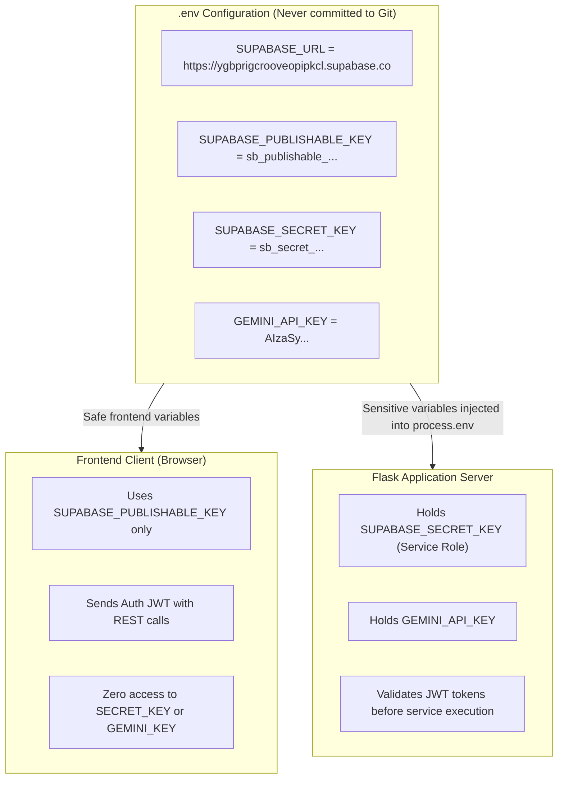

# LIFNEX — SECURITY THREAT MODEL & MITIGATION PLAN

**Project:** Lifnex — Connecting Lives When Every Second Matters  
**Document Stage:** Phase 1 — Complete Project Planning & System Design  
**Framework:** STRIDE Methodology (Spoofing, Tampering, Repudiation, Information Disclosure, Denial of Service, Elevation of Privilege)  
**Standard:** OWASP Top 10 API Security Compliance

---

## 1. Security Architecture Core Principles

1. **Defense in Depth**: Security controls operate across browser client, Flask API layer, Supabase PostgreSQL RLS, and network transport.
2. **Zero-Trust Data Layer**: Supabase PostgreSQL never trusts client inputs. Row Level Security (RLS) is active across every public schema table.
3. **Secret Isolation**:
   - `SUPABASE_SECRET_KEY` and `GEMINI_API_KEY` are stored strictly on the backend server environment and **never** exposed to client JavaScript or git repositories.
   - Frontend is provided only `SUPABASE_PUBLISHABLE_KEY` (anon key), strictly bounded by RLS policies.
4. **Principle of Least Privilege**: User roles (`patient`, `donor`, `hospital`, `admin`) are assigned server-side. Frontend role toggling is strictly prohibited.

---

## 2. STRIDE Threat Analysis & Mitigations

| Threat Category | Specific Threat Scenario | Risk Level | Architectural Mitigation in Lifnex |
|---|---|---|---|
| **Spoofing** | Attacker impersonates a donor or hospital to harvest patient data or forge donation confirmations. | **CRITICAL** | 1. Supabase Auth generates cryptographically signed JWTs.<br>2. Flask backend validates JWT claims via Supabase public key / auth client.<br>3. Hospital actions require explicit verification by Admin before write privileges are granted. |
| **Tampering** | Malicious user alters emergency request parameters (e.g. changing delivery hospital or blood group) or manipulates donor response records. | **HIGH** | 1. Database schema constraints (`CHECK` conditions on blood group, units, coordinates).<br>2. Row Level Security policies restrict `UPDATE` operations strictly to the record creator.<br>3. Flask backend sanitizes and validates all payloads using Marshmallow/Pydantic schemas before writing. |
| **Repudiation** | Hospital or donor denies having accepted an emergency request or confirming a donation. | **MEDIUM** | 1. Dedicated `audit_logs` table records every critical event with actor UUID, action, IP address, and timestamp.<br>2. `donation_history` requires a unique `verification_certificate_no` generated at time of certification. |
| **Information Disclosure** | Unauthorized actors scrape donor telephone numbers, home coordinates, or patient medical histories. | **CRITICAL** | 1. Donor phone numbers and exact GPS coordinates are masked at the database level.<br>2. Proximity searches use distance calculations and fuzzy geographic buffers rather than raw coordinates.<br>3. Detailed donor contact information is only visible to the requesting patient/hospital **after** the donor explicitly submits an `accepted` response. |
| **Denial of Service (DoS)** | Script floods `/api/v1/requests` with thousands of fake emergency requests, exhausting donor attention and server memory. | **HIGH** | 1. Rate limiting on Flask endpoints (Flask-Limiter) restricted by IP and user JWT.<br>2. Maximum 3 active concurrent requests per standard unverified patient account.<br>3. CAPTCHA / client proof checks on public contact forms if spam detected. |
| **Elevation of Privilege** | Normal patient or donor submits a payload modifying their role to `admin` or `hospital`. | **CRITICAL** | 1. The `role` column in `users` is excluded from user profile update endpoints (`PUT /api/v1/auth/profile`).<br>2. Supabase RLS policy `WITH CHECK (role = OLD.role)` prevents client-side role modification.<br>3. Admin endpoints check `user.role == 'admin'` on server-side before execution. |

---

## 3. Row Level Security (RLS) Policy Specifications

```sql
-- Enable RLS across all tables
ALTER TABLE users ENABLE ROW LEVEL SECURITY;
ALTER TABLE donor_profiles ENABLE ROW LEVEL SECURITY;
ALTER TABLE hospitals ENABLE ROW LEVEL SECURITY;
ALTER TABLE blood_requests ENABLE ROW LEVEL SECURITY;
ALTER TABLE donor_responses ENABLE ROW LEVEL SECURITY;
ALTER TABLE notifications ENABLE ROW LEVEL SECURITY;
ALTER TABLE donation_history ENABLE ROW LEVEL SECURITY;
ALTER TABLE verification_records ENABLE ROW LEVEL SECURITY;
ALTER TABLE audit_logs ENABLE ROW LEVEL SECURITY;

-- 1. Users table policies
CREATE POLICY "Users can read own profile" ON users
  FOR SELECT USING (auth.uid() = id);

CREATE POLICY "Users can update own profile (excluding role)" ON users
  FOR UPDATE USING (auth.uid() = id)
  WITH CHECK (auth.uid() = id AND role = (SELECT role FROM users WHERE id = auth.uid()));

-- 2. Donor profiles policies
CREATE POLICY "Donors can view and edit own profile" ON donor_profiles
  FOR ALL USING (auth.uid() = user_id);

CREATE POLICY "Public can view non-sensitive donor data" ON donor_profiles
  FOR SELECT USING (availability_status = 'available');

-- 3. Blood requests policies
CREATE POLICY "Public read for open requests" ON blood_requests
  FOR SELECT USING (status IN ('open', 'in_progress'));

CREATE POLICY "Patients create own requests" ON blood_requests
  FOR INSERT WITH CHECK (auth.uid() = patient_id);

CREATE POLICY "Creator or Hospital update request" ON blood_requests
  FOR UPDATE USING (auth.uid() = patient_id OR auth.uid() IN (SELECT user_id FROM hospitals WHERE id = hospital_id));

-- 4. Audit logs policies (Tamper-proof)
CREATE POLICY "Admins read audit logs" ON audit_logs
  FOR SELECT USING ((SELECT role FROM users WHERE id = auth.uid()) = 'admin');

CREATE POLICY "No public updates to audit logs" ON audit_logs
  FOR UPDATE USING (false);

CREATE POLICY "No public deletions from audit logs" ON audit_logs
  FOR DELETE USING (false);
```

---

## 4. Key Management & Environment Security



### Protection Checklist:
- [x] `.gitignore` contains `.env`, `.env.local`, `*.pyc`, `__pycache__/`, `venv/`.
- [x] Backend returns sanitized responses without database column leaks.
- [x] Content Security Policy (CSP) and CORS headers configured in Flask backend.
- [x] HTML inputs sanitized against XSS using strict textContent DOM bindings instead of innerHTML.
- [x] Parameterized SQL queries or Supabase ORM calls only (Zero string concatenation in queries).

