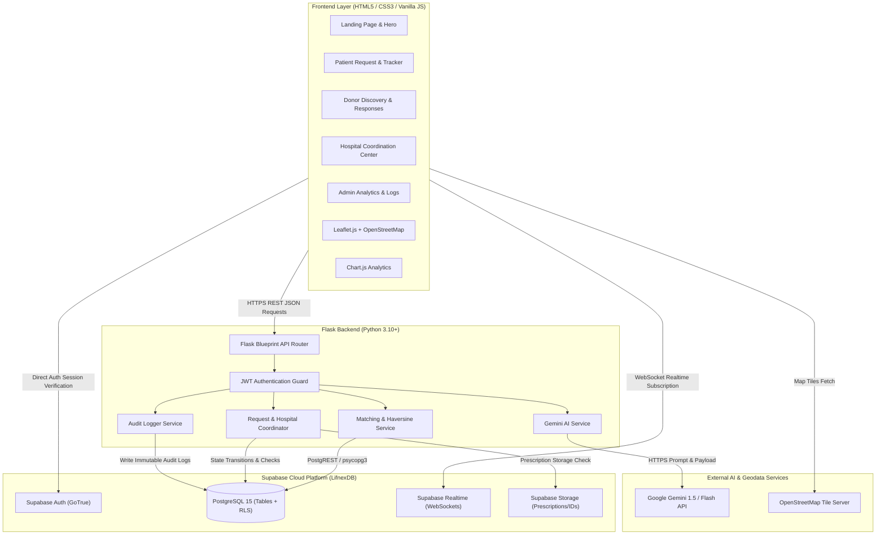
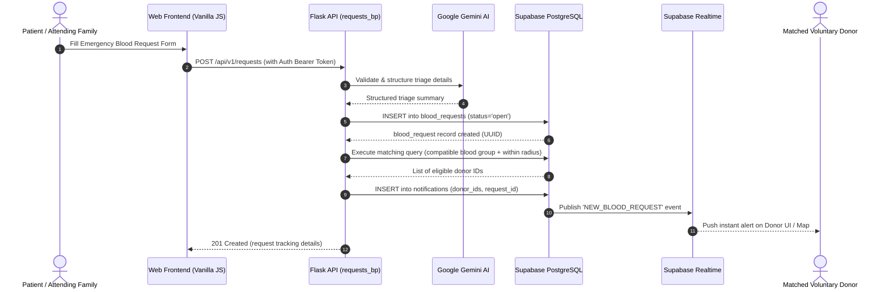
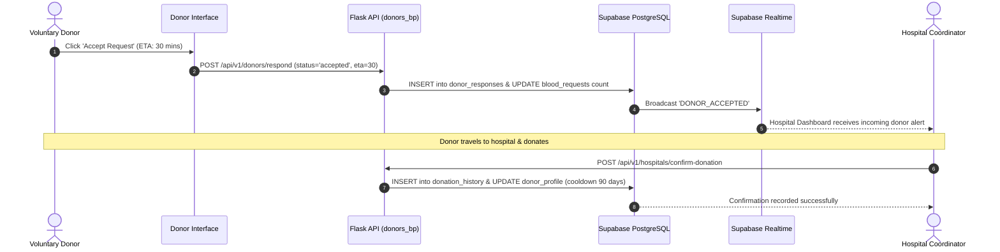
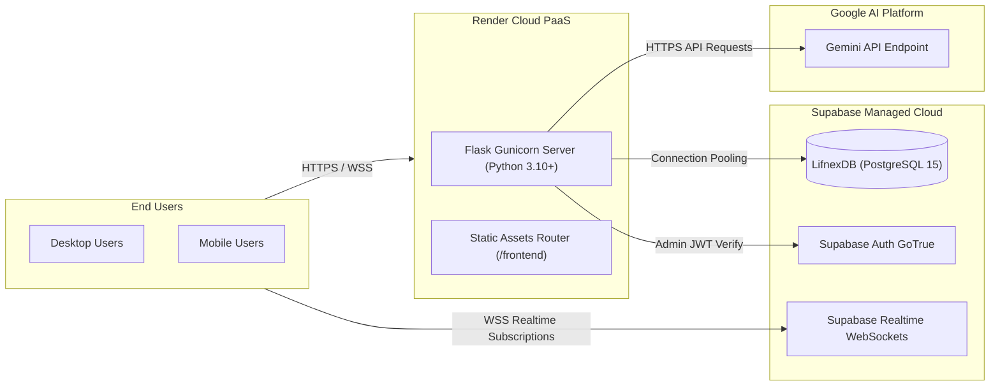

# LIFNEX — SYSTEM ARCHITECTURE SPECIFICATION

**Project:** Lifnex — Connecting Lives When Every Second Matters  
**Document Stage:** Phase 1 — Complete Project Planning & System Design  
**Architecture Pattern:** Modular Monolithic Backend with Decoupled Single-Page Client

---

## 1. Architectural Philosophy

Lifnex uses a **Modular Monolith** pattern:
- **Presentation Layer**: Static Vanilla HTML5, CSS3, and ES6 JavaScript served directly or via Flask static routes, eliminating heavy client-side bundlers.
- **Application Services Layer (Flask REST API)**: Clean, testable Python Flask blueprints orchestrating business logic, AI interactions, distance calculations, and authorization.
- **Data & Realtime Layer (Supabase)**: High-performance PostgreSQL database, managed identity (Supabase Auth), Row Level Security (RLS), real-time WebSockets, and file storage.
- **External AI & Geodata Engines**: Google Gemini API for intelligent parsing/triage, OpenStreetMap and Leaflet.js for mapping.

---

## 2. Layered Component Responsibilities

### 2.1 Frontend Presentation Layer (Vanilla Web Stack)
- **Technology**: Native HTML5, modern modular CSS3, Vanilla ES6 JavaScript (Fetch API, DOM manipulation).
- **Zero-Build Architecture**: Runs in any modern browser without Webpack, Vite, or Node.js runtime dependencies on the client side.
- **Leaflet.js & OpenStreetMap**: Interactive map rendering, marker clustering for donors and hospitals, radius overlays.
- **Chart.js**: Dynamic visual dashboards for blood inventory, request trends, and donor demographics.

### 2.2 Flask Application Service Layer (Backend REST API)
- **Blueprints**:
  - `auth_bp`: Token validation helper, user registration profile synchronizer.
  - `requests_bp`: Emergency blood request creation, listing, status updates, and tracking.
  - `donors_bp`: Donor profile management, availability toggle, and response submission.
  - `matching_bp`: Blood compatibility matrix and Haversine distance ranking algorithms.
  - `hospitals_bp`: Hospital directory, inventory status, and verification actions.
  - `ai_bp`: Interface with Google Gemini API for intelligent medical request structuring and donor advisory.
  - `admin_bp`: Audit log review, user management, and system-wide metrics.

### 2.3 Data, Auth, and Storage Layer (Supabase Platform)
- **PostgreSQL 15**: ACID-compliant relational storage with custom constraints, triggers, and indexes.
- **Row Level Security (RLS)**: Enforces table-level and row-level authorization directly in the database engine.
- **Supabase Realtime**: Listens to PostgreSQL `WAL` (Write-Ahead Logging) to broadcast `INSERT` and `UPDATE` events to connected frontend clients instantaneously.
- **Supabase Storage**: Secure buckets for medical prescriptions, identity verifications, and hospital license documents.

---

## 3. Data Flow Architectures

### 3.1 Emergency Request Submission & Donor Notification Flow

### 3.2 Donor Response & Hospital Verification Flow

---

## 4. Deployment Topology (Render & Supabase Cloud)

