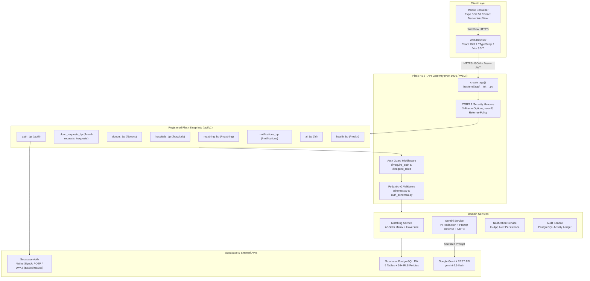

# Lifnex — System Architecture Specification

> **Tagline:** *Connecting Lives When Every Second Matters.*  
> **Scope Notice:** Lifnex is strictly an emergency donor coordination network. It is **not** a blood bank and does not perform physical blood storage or clinical cross-matching.

---

## 1. Architectural Overview

Lifnex employs a decoupled multi-tier web and mobile architecture:
- **Client Layer:** React 18 SPA bundled with Vite 8 (`frontend/src/`) and an Expo SDK 51 React Native hybrid container (`mobile/App.js`).
- **Gateway & REST Layer:** Python 3.11 / Flask 3.1.0 Application Factory (`backend/app/__init__.py`) exposing 7 registered REST Blueprints and serving compiled static assets (`frontend/dist/`).
- **Security & Validation Layer:** Asymmetric JWKS / PyJWT verification (`backend/app/utils/auth_guard.py`), role-based decorators (`@require_auth`, `@require_roles`), and strict Pydantic v2 payload schemas (`backend/app/validators/`).
- **Business Services Layer:** Biological compatibility and Haversine matching (`matching_engine.py`, `matching_service.py`), Gemini AI clinical governance (`gemini_service.py`), notification dispatch (`notification_service.py`), and audit logging (`audit_service.py`).
- **Persistence & Auth Layer:** Supabase Auth + PostgreSQL 15+ (`backend/migrations/001_initial_schema.sql`, `002_security_hardening.sql`) with Row-Level Security (RLS).

---

## 2. High-Level System Architecture Diagram

---

## 3. Frontend Architecture (`frontend/src/`)

- **Entrypoint & Routing:** `frontend/src/main.tsx` mounts `App.tsx`, which configures `ThemeProvider` (day/night theme tokens in `styles/tokens.css`) and `BrowserRouter` with lazy-loaded route definitions in `frontend/src/lib/routes.tsx`.
- **Multi-Entry HTML Shells:** `vite.config.ts` compiles 17 HTML entry points (`index.html`, `login.html`, `register.html`, `verify-otp.html`, `dashboard/*.html`, etc.), generated via `scripts/make-shells.js`, enabling direct route loading on both Vite dev server and static/Vercel hosting.
- **API Client:** `frontend/src/services/api.ts` centralizes all `fetch('/api/v1/...')` calls, injecting `Authorization: Bearer <lifnex_token>` from `localStorage`.
- **3D & Motion Components:** `BloodStream.tsx`, `Hero3DCanvas.tsx`, `Mini3DDroplet.tsx` (Three.js / React Three Fiber), plus interactive ReactBits primitives (`RubberSegment`, `ClickSpark`, `Radar`, `SloshGauge`, `SpotlightCard`) under `frontend/src/components/reactbits/`.
- **Dashboards:** Role-specific portals in `frontend/src/pages/dashboards/` (`PatientDashboard.tsx`, `DonorDashboard.tsx`, `HospitalDashboard.tsx`, `AdminDashboard.tsx`).

---

## 4. Backend Architecture (`backend/app/`)

| Module | Path | Responsibility |
|---|---|---|
| **App Factory** | `backend/app/__init__.py` | Initializes Flask, CORS, security headers, SPA fallback, and 8 blueprint registrations (7 unique + 1 `/requests` alias). |
| **Configuration** | `backend/app/config.py` | Loads root `.env`, enforces Staging project allowlist (`APPROVED_STAGING_PROJECT_REFS`), blocks prohibited production refs (`PROHIBITED_PROJECT_REFS`). |
| **DB Client** | `backend/app/core/supabase_client.py` | Instantiates `get_supabase_admin()` (service-role) and `get_supabase_anon()` (publishable key), with offline fallback handling. |
| **Auth Guard** | `backend/app/utils/auth_guard.py` | Verifies ES256/RS256 tokens via JWKS and HS256 test/session tokens; injects `g.user` and enforces `@require_roles`. |
| **Routes** | `backend/app/routes/*.py`, `api/v1/matching.py` | REST endpoints for auth, blood requests, donors, hospitals, matching, notifications, AI, and health. |
| **Services** | `backend/app/services/*.py` | Business logic isolated from HTTP transport. |
| **Validators** | `backend/app/validators/*.py` | Pydantic v2 input validation (`BloodRequestCreate`, `RegisterRequest`, `HospitalCreate`, etc.). |

> **Architecture Note on Legacy Files:** `backend/app/api/v1/` contains legacy prototype files (`donors.py`, `health.py`, `requests.py`) that are **not** registered in `create_app()`. Only `backend/app/api/v1/matching.py` and `backend/app/routes/*.py` are active.

---

## 5. Mobile Architecture (`mobile/`)

- **Framework:** Expo `~51.0.0`, React Native `0.74.5`, `react-native-webview` `13.8.6` (`mobile/package.json`).
- **Implementation:** `mobile/App.js` renders a branded dark header (`#0A0D14` / `#FF2E54`) wrapping a full-screen `WebView` pointing to `DEV_URL` (`http://10.0.2.2:5173` for Android emulator) with `javaScriptEnabled` and `domStorageEnabled`.
- **Build Configuration:** `mobile/eas.json` defines `development`, `preview` (`buildType: "apk"`), and `production` (`buildType: "app-bundle"`) profiles. Physical APK generation is **deferred** and has not been compiled yet.
