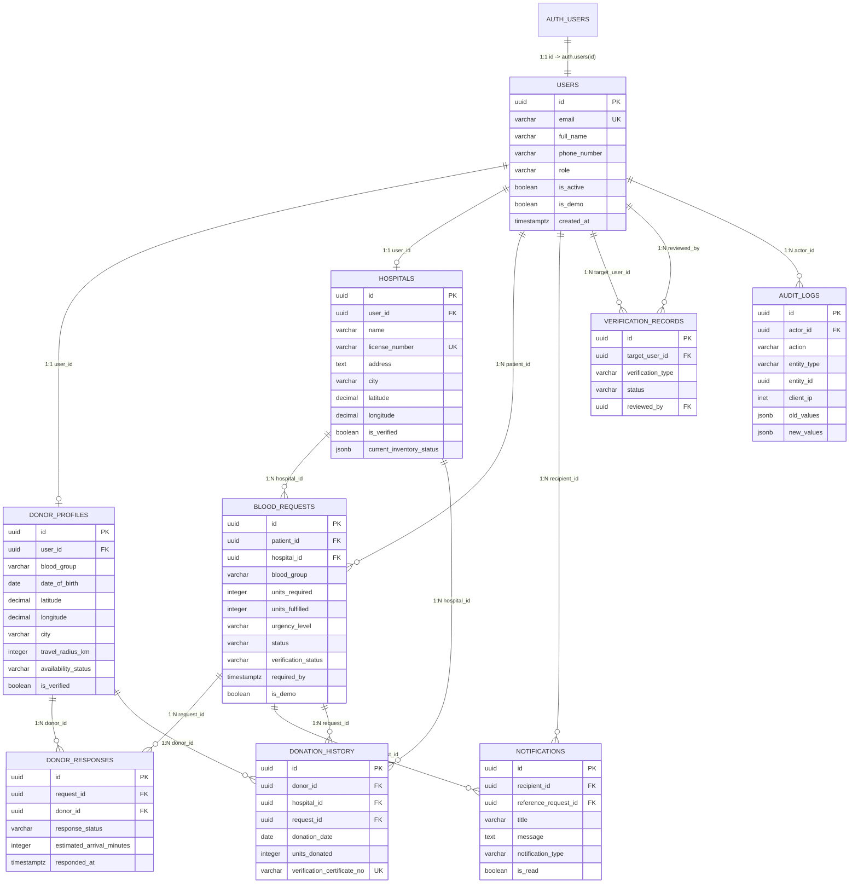

# Lifnex — Database Architecture & ER Specification

> **Engine:** Supabase PostgreSQL 15+  
> **Migration Scripts:** `backend/migrations/001_initial_schema.sql` and `backend/migrations/002_security_hardening.sql`

---

## 1. Entity Relationship Diagram

---

## 2. Table Definitions (9 Core Tables)

| Table | Primary Key | Foreign Keys | Key Constraints & Checks |
|---|---|---|---|
| `public.users` | `id` (`UUID`) | `auth.users(id)` `ON DELETE CASCADE` | `email` UNIQUE; `role IN ('patient','donor','hospital','admin')` |
| `public.donor_profiles` | `id` (`UUID`) | `users(id)` UNIQUE `ON DELETE CASCADE` | `blood_group` 8 ABO/Rh values; `travel_radius_km BETWEEN 1 AND 100`; `availability_status IN ('available','busy','inactive','cooldown')` |
| `public.hospitals` | `id` (`UUID`) | `users(id)` UNIQUE `ON DELETE CASCADE` | `license_number` UNIQUE; `jsonb_typeof(current_inventory_status) = 'object'` |
| `public.blood_requests` | `id` (`UUID`) | `users(id)` (`patient_id`), `hospitals(id)` (`hospital_id` `RESTRICT`) | `units_required BETWEEN 1 AND 20`; `units_fulfilled <= units_required`; `urgency_level IN ('normal','urgent','critical')` |
| `public.donor_responses` | `id` (`UUID`) | `blood_requests(id)` `CASCADE`, `donor_profiles(id)` `CASCADE` | `UNIQUE (request_id, donor_id)` prevents duplicate handshakes; `estimated_arrival_minutes >= 0` |
| `public.notifications` | `id` (`UUID`) | `users(id)` (`recipient_id`), `blood_requests(id)` `SET NULL` | `notification_type IN ('emergency_alert','response_update','verification','system')` |
| `public.donation_history` | `id` (`UUID`) | `donor_profiles(id)` `RESTRICT`, `hospitals(id)` `RESTRICT`, `blood_requests(id)` `SET NULL` | `verification_certificate_no` UNIQUE; `units_donated > 0` |
| `public.verification_records` | `id` (`UUID`) | `users(id)` (`target_user_id`), `users(id)` (`reviewed_by` `SET NULL`) | `verification_type IN ('hospital_license','donor_health_screen','medical_request')` |
| `public.audit_logs` | `id` (`UUID`) | `users(id)` (`actor_id` `SET NULL`) | Append-only JSONB `old_values`/`new_values` with `INET client_ip` |

---

## 3. Indexing Strategy (`001_initial_schema.sql`)

- **Composite Matching Indexes:** `idx_donors_matching (blood_group, availability_status, last_donation_date)` and `idx_donors_city_blood_availability (city, blood_group, availability_status)`.
- **Geospatial Coordinate Indexes:** `idx_donors_coords (latitude, longitude)` and `idx_hospitals_coords (latitude, longitude)`.
- **Request Queue Indexes:** `idx_requests_status_urgency (status, urgency_level, blood_group)` and partial index `idx_requests_required_by (required_by) WHERE status IN ('open', 'in_progress')`.
- **Notification & Audit Indexes:** `idx_notifications_recipient_read (recipient_id, is_read)` and `idx_audit_created (created_at DESC)`.

---

## 4. Row-Level Security (RLS) Design

- **Fail-Closed Base (`001_initial_schema.sql`):** Enables `ROW LEVEL SECURITY` on all 9 tables and executes `REVOKE ALL ON TABLE ... FROM anon, authenticated;` so no data is exposed prior to policy installation.
- **Security Hardening (`002_security_hardening.sql`):** Installs `SECURITY DEFINER` helper functions (`get_auth_user_role()`, `is_admin()`, `is_verified_hospital()`, etc.) pinned to `SET search_path = public, pg_temp` with `PUBLIC` execution revoked, enforcing strict ownership and role-based read/write isolation at the PostgreSQL layer.
