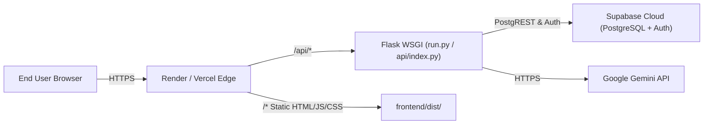

# Lifnex — Deployment & Operations Guide

---

## 1. Local Full-Stack Execution (Recommended)

A single Flask process serves both the REST API (`/api/v1/*`) and the compiled Vite frontend (`frontend/dist/`):

```powershell
# 1. Install and build frontend bundle
npm install
npm run build

# 2. Create Python environment and install dependencies
python -m venv .venv
.\.venv\Scripts\python -m pip install -r requirements.txt

# 3. Start Flask server on port 5000
.\.venv\Scripts\python run.py
```

For hot-reload frontend development, keep `run.py` active on port `5000` and start Vite in a second terminal (`npm run dev` on `http://localhost:5173`, which proxies `/api` to `http://127.0.0.1:5000`).

---

## 2. Cloud Deployment Targets

### Option A: Render (`render.yaml`)
`render.yaml` configures a unified Python web service:
- **Build Command:** `npm install --include=dev && npm run build && pip install -r requirements.txt`
- **Start Command:** `gunicorn run:app --bind 0.0.0.0:$PORT --workers 2 --timeout 120`
- **Health Check:** `/api/v1/health`

### Option B: Vercel (`vercel.json` + `api/index.py`)
`vercel.json` builds the Vite bundle (`npm run build`) and routes `/api/(.*)` to the serverless WSGI entrypoint `api/index.py` (verified via `backend/tests/test_vercel_entrypoint.py`).

### Deployment Diagram



---

## 3. Supabase Database Setup

1. Ensure `SUPABASE_URL`, `SUPABASE_PUBLISHABLE_KEY`, `SUPABASE_SECRET_KEY`, and `SUPABASE_JWKS_URL` are set in `.env` (never commit `.env`).
2. In the Supabase SQL Editor, execute migrations in strict order:
   1. `backend/migrations/001_initial_schema.sql` (creates 9 tables, indexes, and fail-closed RLS)
   2. `backend/migrations/002_security_hardening.sql` (installs `SECURITY DEFINER` helpers and 36+ RLS policies)
3. Optional: seed the 4 staging demo accounts (`patient`, `donor`, `hospital`, `admin`) using `python scripts/seed_demo_accounts.py`.

---

## 4. Mobile Companion App (`mobile/`)

- Configured with Expo SDK 51 (`mobile/app.json`, `mobile/eas.json`).
- Run locally via `cd mobile && npm install && npx expo start`.
- **Android APK Status:** EAS `preview` profile (`buildType: "apk"`) is configured, but physical `.apk` compilation is **deferred**.
