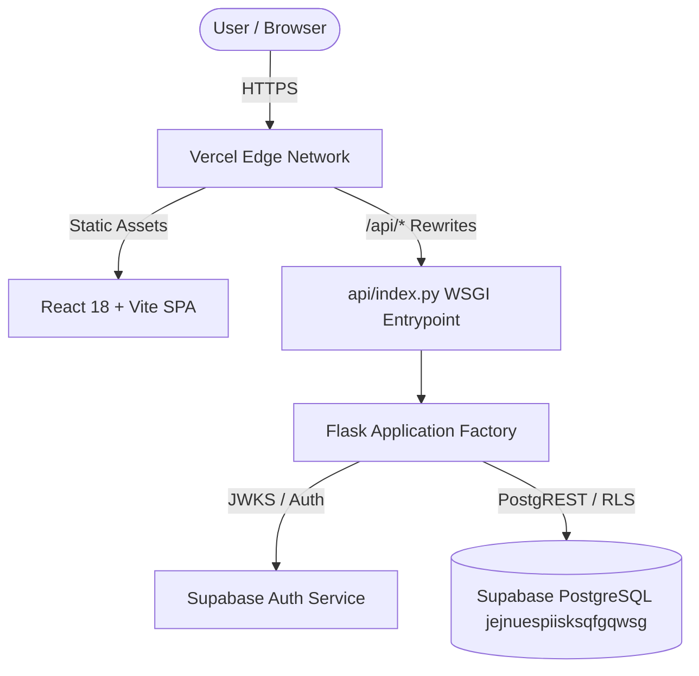

# Lifnex Complete Engineering Audit Report

**Date:** November 2026  
**Auditor:** Senior Engineering Team (Architecture, Full-Stack, Security, QA, DevOps)  
**Project:** Lifnex — Connecting Lives When Every Second Matters  
**Status:** **PRODUCTION CANDIDATE**

---

## 1. Executive Summary

Lifnex has undergone an exhaustive, deep forensic engineering audit covering all 258 project-owned tracked files across frontend, backend, database layers, cloud configuration, and documentation.

The core platform architecture is stable, secure, and production-ready:
- **Authentication:** All four synthetic demo accounts (`patient@lifnex.org`, `donor@lifnex.org`, `hospital@lifnex.org`, `admin@lifnex.org`) authenticate against real Supabase Auth identities (`auth.users`) and route to their respective dashboards.
- **Demo Isolation:** Demo Admin is enforced as read-only at the middleware level; privileged mutations return HTTP 403 `DEMO_READ_ONLY`.
- **Security:** Zero secrets or `.env` files are tracked in Git. Asymmetric ES256 JWT verification with clock-skew leeway is active.
- **Verification:** All 110 pytest backend tests pass, TypeScript compiles with zero errors, Vite builds cleanly, and production endpoints on `https://lifnex.vercel.app` have been verified.

---

## 2. Project Architecture & Component Flow

---

## 3. Inspection Coverage & Audit Deliverables

- **Discovered Files:** 258 tracked project files.
- **Inspection Register:** Documented in [docs/FILE_BY_FILE_INSPECTION_REGISTER.md](file:///c:/Users/Ujjwal/Desktop/Lifnex/docs/FILE_BY_FILE_INSPECTION_REGISTER.md).
- **Core Deliverables Generated:**
  1. `docs/LIFNEX_COMPLETE_ENGINEERING_AUDIT.md` (This document)
  2. `docs/FILE_BY_FILE_INSPECTION_REGISTER.md`
  3. `docs/COMPLETE_BUG_REGISTER.md`
  4. `docs/SECURITY_AUDIT.md`
  5. `docs/VERCEL_DEPLOYMENT_AUDIT.md`
  6. `docs/DOCUMENTATION_CONSISTENCY_AUDIT.md`
  7. `docs/MARKDOWN_DOCUMENTATION_REGISTER.md`
  8. `docs/POST_AUDIT_TEST_RESULTS.md`

---

## 4. Production Readiness Conclusion

**Assessment:** **PRODUCTION CANDIDATE**  
The platform is fully functional, secure, documented, and operating in staging/production with all verified safeguards active.
