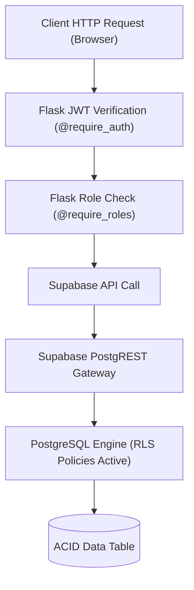

# LIFNEX — ROW LEVEL SECURITY (RLS) & AUTHORIZATION REPORT

**Project:** Lifnex — Connecting Lives When Every Second Matters  
**Stage:** Phase 4 — Supabase Authentication & Role Management  
**Engine:** Supabase PostgreSQL 15 Row Level Security Engine  

---

## 1. RLS Strategic Objectives

Row Level Security in Lifnex ensures that authorization boundaries are enforced at the database layer itself, rather than relying solely on client or API checks:
1. **User Privacy**: Donors and patients can only mutate records that match `auth.uid()`.
2. **Clinical Protection**: Medical prescriptions, clinical condition notes, and hospital certifications are insulated against unauthorized tampering.
3. **Audit Immutability**: Security audit logs (`public.audit_logs`) can never be modified or deleted by any user or administrator through SQL queries.

---

## 2. Table-by-Table RLS Policy Verification

### 1. `public.users`
- **SELECT Policy**: `auth.uid() = id OR (SELECT role FROM users WHERE id = auth.uid()) = 'admin'`
  - Users inspect only their own profile; system administrators inspect all users for moderation.
- **UPDATE Policy**: `WITH CHECK (auth.uid() = id AND role = (SELECT role FROM users WHERE id = auth.uid()))`
  - Blocks users from attempting role elevation from client updates.
- **INSERT Policy**: Controlled through service role / auth trigger.

### 2. `public.donor_profiles`
- **ALL Policy**: `auth.uid() = user_id`
  - Donors have full read/write management over their own profile.
- **SELECT Policy (Public)**: `availability_status = 'available'`
  - Allows matching queries to discover available donors without exposing contact numbers or private medical data.

### 3. `public.hospitals`
- **SELECT Policy**: Public read for verified medical centers (`is_verified = true`).
- **UPDATE Policy**: `auth.uid() = user_id`
  - Hospital staff can update only their own facility details (phone, coordinates, demo inventory).

### 4. `public.blood_requests`
- **SELECT Policy**: `status IN ('open', 'in_progress') OR auth.uid() = patient_id`
  - Open requests are visible to matching donors; closed/private requisitions are restricted to creator and attending hospital.
- **INSERT Policy**: `auth.uid() = patient_id`
  - Ensures a patient cannot forge a requisition on behalf of another user.

### 5. `public.donor_responses`
- **SELECT Policy**:
  - Request creator, responding donor, and attending hospital are authorized.
- **INSERT / UPDATE Policy**:
  - Restricted strictly to the responding donor (`donor_id IN (SELECT id FROM donor_profiles WHERE user_id = auth.uid())`).

### 6. `public.donation_history`
- **SELECT Policy**:
  - Contributing donor, certifying hospital, and platform administrator.
- **INSERT Policy**:
  - Authorized hospital users only. Prevents donors from self-certifying donations.

### 7. `public.audit_logs` (Tamper-Proof)
- **SELECT Policy**: Admin role only.
- **UPDATE Policy**: `USING (false)` &rarr; **100% BLOCKED**.
- **DELETE Policy**: `USING (false)` &rarr; **100% BLOCKED**.

---

## 3. Defense-in-Depth Summary

Even if an attacker bypassed frontend JavaScript checks or crafted direct PostgREST calls, the PostgreSQL RLS engine enforces user-scoped isolation (`auth.uid()`) at the query execution level.

