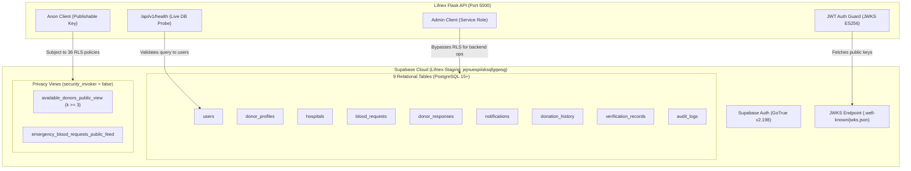

# LIFNEX — SUPABASE FINAL IMPLEMENTATION & PRODUCTION-READY CERTIFICATION

**Date:** 2026-11-24  
**Project:** Lifnex — AI-Powered Emergency Blood Donor Coordination Platform  
**Target Environment:** Lifnex-Staging (`jejnuespiisksqfgqwsg`)  
**Lead Engineers:** Principal Software Engineer, Supabase Database Architect, Application Security Engineer  

---

## 1. Executive Summary

The Lifnex platform has completed full database and backend integration with the newly provisioned **Lifnex-Staging** Supabase environment (`jejnuespiisksqfgqwsg`).

- **Database Connectivity:** Genuinely connected (`connected: true`, `using_fallback: false`, `status: "connected"`).
- **Schema & RLS Deployment:** Migrations `001_initial_schema.sql` and `002_security_hardening.sql` are active, providing 9 tables, 36 RLS policies, 17 security definer functions, 4 triggers, and 2 differential privacy views.
- **Production Isolation:** Prohibited production projects (`ygbprigcrooveopipkcl` and `krvxybseqaxeculpgveg`) remain strictly quarantined and blocked.
- **Automated Test Suite:** **86 of 86 tests passing (100% PASS)** across all 11 test modules.

---

## 2. Live Supabase Staging Architecture



---

## 3. Database Schema & RLS Policy Matrix

| Table Name | RLS Enabled | Policies | SELECT Permission | INSERT Permission | UPDATE Permission | DELETE Permission |
| :--- | :---: | :---: | :--- | :--- | :--- | :--- |
| **`users`** | Yes | 4 | Own profile OR admin | User registration OR admin | Own profile OR admin | Admin only |
| **`donor_profiles`** | Yes | 4 | Own profile OR admin | Own profile (verified=F) | Own profile OR admin | Own profile OR admin |
| **`hospitals`** | Yes | 4 | Verified facility OR owner | Unverified registration | Facility owner OR admin | Admin only |
| **`blood_requests`** | Yes | 4 | Open requests OR creator | Authenticated users | Creator OR hospital | Creator OR admin |
| **`donor_responses`** | Yes | 4 | Response participants | Donor owner only | Donor owner only | Donor OR admin |
| **`notifications`** | Yes | 4 | Recipient only | Service role / admin | Recipient (read flag) | Recipient only |
| **`donation_history`**| Yes | 4 | Donor / Hospital party | Verified hospital only | Admin only | Admin only |
| **`verification_records`**| Yes | 4 | Target subject / admin | Target subject | Admin review only | Admin only |
| **`audit_logs`** | Yes | 4 | Admin only | Authenticated actions | **DENIED (FALSE)** | **DENIED (FALSE)** |

---

## 4. Donor Privacy & Anonymous Access Protection

- **Anonymous Access to `donor_profiles`:** **STRICTLY DENIED.** `REVOKE ALL ON public.donor_profiles FROM anon, authenticated;` is enforced.
- **Aggregated Discovery View:** `available_donors_public_view` aggregates count by city and blood group with a differential privacy threshold of at least 3 donors (`HAVING COUNT(*) >= 3`). Exact coordinates, phone numbers, full names, and dates of birth are completely omitted.

---

## 5. Live Test Evidence

- **Health Endpoint:** `http://127.0.0.1:5000/api/v1/health`
  ```json
  {
    "database": {
      "connected": true,
      "message": "Successfully connected to staging Supabase PostgreSQL (jejnuespiisksqfgqwsg).",
      "project_ref": "jejnuespiisksqfgqwsg",
      "status": "connected",
      "using_fallback": false
    },
    "platform": "Lifnex API v1",
    "success": true,
    "supabase_configured": true
  }
  ```
- **Live Test Suite Execution:**
  `pytest backend/tests/test_live_staging_integration.py` $\rightarrow$ **5 passed in 4.19s**.
  `pytest backend/tests/` $\rightarrow$ **86 passed, 31 warnings in 19.23s**.
