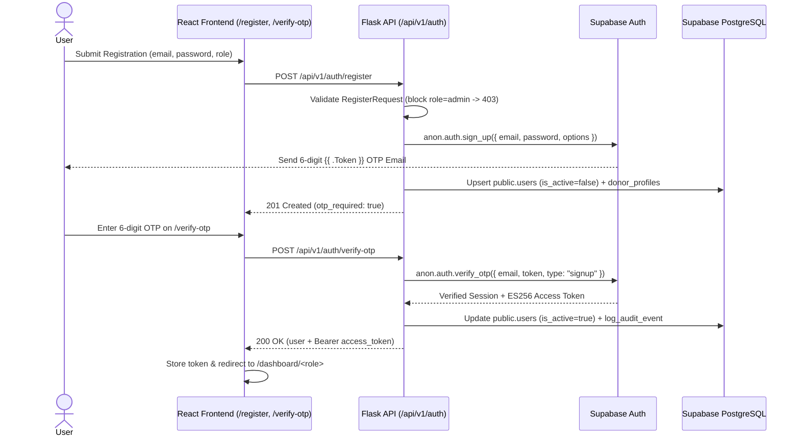
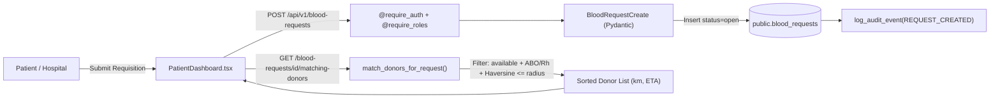
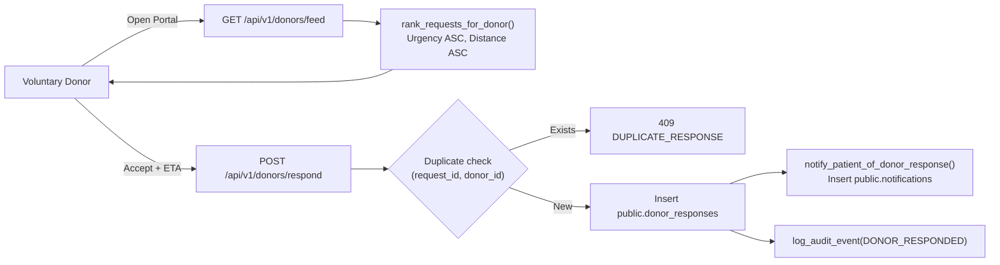
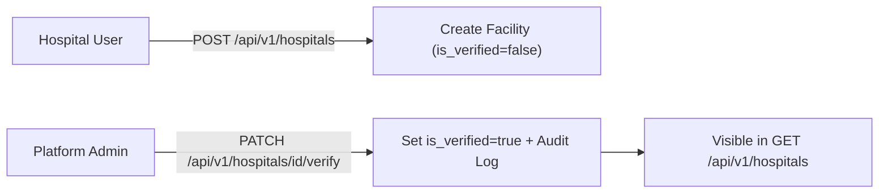
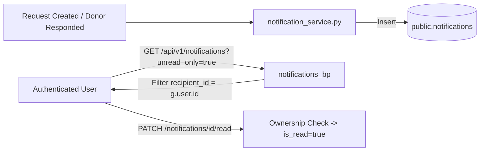

# Lifnex — End-to-End System Workflows

---

## 1. User Authentication & Native Supabase OTP Flow

---

## 2. Emergency Blood Request & Donor Discovery Flow

---

## 3. Donor Feed & Handshake Response Flow

---

## 4. Hospital Coordination & Accreditation Flow

---

## 5. Notification Lifecycle Flow

